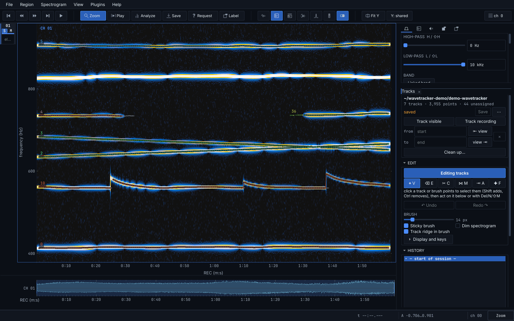

# wavetracker

[](https://github.com/weygoldt/wavetracker/actions/workflows/ci.yml?query=branch%3Amaster)
[](https://github.com/weygoldt/wavetracker/actions/workflows/ci.yml?query=branch%3Amaster)
[](https://doi.org/10.3389/fnint.2022.965211)
[](LICENSE)

Detect and track the EOD frequencies of individual **wave-type electric fish**
in long, multi-electrode recordings.

The pipeline:

1. **Spectrogram** – static is removed from the traces, then one-sided power
   spectral densities of every electrode are computed block-wise on the GPU
   with PyTorch (CPU works too). Stationary interference combs are detected
   and removed per electrode.
2. **Harmonic groups** – peaks of the electrode-summed spectrum are grouped
   into harmonic series; each group is one fish (parallel numba code).
3. **Tracking** – detections are linked into identities using their
   frequency and their amplitude pattern across electrodes
   ([Raab et al. 2022](https://doi.org/10.3389/fnint.2022.965211)).
4. **Stitching** – track fragments are joined across rises, dropouts and
   short double detections. For dense populations, a learned linker
   (`linking.enabled: true`) joins them better
   ([Learned linking](docs/algorithms.md#learned-linking)).

Set the frequency range of your fish (see [Usage](#usage)); the default
range is a broad catch-all.

A recording may start long before there is a fish in it, with the electrodes
still out of the water or in empty water, for seconds or for hours: results for
a fish [do not depend on what came before](docs/algorithms.md#recordings-without-fish).

It runs at several hundred times realtime on an 11-channel, 20 kHz recording
(a 4 h recording takes about a minute on an RTX 4080, mostly disk IO).

## Installation

Requires Python 3.11–3.14. With [uv](https://docs.astral.sh/uv/):

```bash
git clone https://github.com/weygoldt/wavetracker.git
cd wavetracker
uv sync
uv run wavetracker --help
```

or with pip into an existing environment: `pip install -e .`.

PyTorch from PyPI ships with CUDA support on Linux; the GPU is used
automatically when available (`--device cpu` forces the CPU).

## Usage

```bash
wavetracker info  /data/2022-05-10-10_00                 # channels, rate, duration
wavetracker run   /data/2022-05-10-10_00 -o results/0510 # detect + track
wavetracker run   /data/2022-05-10-10_00 -o test --start 3600 --duration 300
wavetracker summary results/0510                          # table of identities
wavetracker plot    results/0510 -o tracks.png            # tracks on spectrogram
wavetracker track   results/0510 -c my_config.yaml        # re-track only
```

> **Important: set the fish frequency range explicitly, as narrow as you
> can.** The default (fundamentals from 80 to 2400 Hz) is a catch-all for
> unknown populations, from *Sternopygus* to the fastest *Apteronotus*. If
> you know the EOD frequencies of your fish, or the range they can be
> expected in, restrict `harmonic_groups.min_freq`/`max_freq` to a narrow
> band around it (with some margin for drift and rises). This maximizes
> performance in every respect:
>
> * **Interference removal.** Hum combs are only removed if they are spaced
>   closer than the lowest fish frequency (anything wider could be a
>   resting fish's harmonic series). With the default range that is only
>   combs below 72 Hz; with 400–1200 Hz combs up to 300 Hz are removed.
> * **Fewer false fish.** Harmonics and interference outside the band cannot
>   become fish. On a grid recording with a 95 Hz hum comb the default range
>   gave 3× the detections and `cleanup -n 2` coverage dropped from 92 % to
>   50 %; with 400–1200 Hz the result was clean.
> * **Speed.** ~3× faster detection (17 s instead of 51 s for 4 h).
>
> ```yaml
> harmonic_groups:
>   min_freq: 400.0   # e.g. Apteronotus leptorhynchus in the lab
>   max_freq: 1200.0
> ```
>
> `wavetracker run` prints a reminder when the default range is in use.

`run` accepts a single file, a fishgrid recording directory
(`traces-grid*.raw` + `fishgrid.cfg`) or a directory with a sequence of audio
files (read as one continuous recording via
[thunderlab](https://github.com/bendalab/thunderlab)). Several inputs can be
given at once; each gets a subdirectory of `--output`. Existing results are
skipped unless `-f/--overwrite` is given.

Post-processing and tools:

| command | purpose |
|---|---|
| `wavetracker cleanup DIR -n 2` | join/filter tracks, keep the N most prominent fish |
| `wavetracker harmonics DIR` | find identities that are harmonics of another fish |
| `wavetracker merge-by-position DIR -e electrodes.npz` | group track segments into fish by frequency and position (moving electrodes) |
| `wavetracker concat DAY1 DAY2 … -o OUT` | concatenate consecutive recordings |
| `wavetracker freq-analysis DIRS…` | top-N frequencies at fixed times of day |
| `wavetracker synth out.wav -n 4` | synthetic recording with ground truth |
| `wavetracker config [FILE]` | print or write the default configuration |

### Configuration

All parameters live in one YAML file: `wavetracker config cfg.yaml` writes the
defaults, pass your edited copy with `-c cfg.yaml`. The
[parameter reference](docs/configuration.md) lists the relevant ones and every
file in a results directory.

### Results

A results directory holds plain NumPy files ([reference](docs/configuration.md#output)):

```python
from wavetracker.results import Results

r = Results.load("results/0510")
for fish in r.ids():
    m = r.ident_v == fish
    t, f = r.times[r.idx_v[m]], r.fund_v[m]
```

### Python API

```python
from wavetracker.config import Config
from wavetracker.pipeline import detect, track_results

cfg = Config.load("cfg.yaml")  # or Config()
out = detect("/data/rec", "results/rec", cfg, start=0, duration=600)
track_results(out.results, cfg)
out.results.save("results/rec")
```

`wavetracker.synthetic` generates recordings of fish with known frequency
traces and `wavetracker.evaluation.evaluate` scores results against them
(precision, recall, identity coverage and purity).

## Correcting tracks interactively

No tracker is right everywhere: rises split a fish into fragments, crossing
fish swap identities, harmonics get tracked as fish. The fix is to look and
correct, in [audian](https://github.com/weygoldt/audian), a recording viewer
whose wavetracker plugin runs the pipeline and edits its output on the
spectrogram.



```bash
git clone https://github.com/weygoldt/audian.git
cd audian
uv sync                     # installs wavetracker into the same environment
uv run audian recording.wav # then Plugins → Wavetracker
```

*Track recording* runs wavetracker on the whole file in the background
(*Track visible* on just the window in view), or open an existing results
directory. In edit mode, brushes select, erase, cut, merge, assign and add
tracks (*Add* follows the spectrogram ridge under the brush), with an undo
history; tracks that are harmonics of another fish are flagged. Saving keeps
the original identities as `ident_v.tracked.npy` and the directory stays
readable by `Results.load`.

New to it? The [quickstart](https://github.com/weygoldt/audian/blob/master/docs/wavetracker-quickstart.md)
walks through tracking and correcting a demo recording in about 15 minutes.

## Documentation

* [Configuration and output](docs/configuration.md) – parameter reference, the
  files of a results directory.
* [How it works](docs/algorithms.md) – differences to the original
  implementation, interference removal, stitching, known limitations.
* [Post-processing](docs/post-processing.md) – cleanup, harmonics tracked as
  fish, merging by position for moving electrodes.
* [Field recordings and dense populations](docs/field-recordings.md) – settings
  and observations for short recordings with many fish.
* [Benchmarks](docs/benchmarks.md) – results on tube-competition recordings,
  dense mixtures and synthetic low-frequency fish.

## Development

```bash
uv sync
uv run pytest            # tests using recordings in /mnt/data2 are skipped if absent
uv run ruff check . && uv run ruff format .
```

`tests/legacy_tracking.py` holds the original tracker as a frozen reference for
the equivalence tests.

## Citation

Raab T, Madhav MS, Jayakumar RP, Henninger J, Cowan NJ, Benda J (2022).
*Advances in non-invasive tracking of wave-type electric fish in natural and
laboratory settings.* Front. Integr. Neurosci. 16:965211.
[doi:10.3389/fnint.2022.965211](https://doi.org/10.3389/fnint.2022.965211)

## License

[GPL-3.0-or-later](LICENSE)
