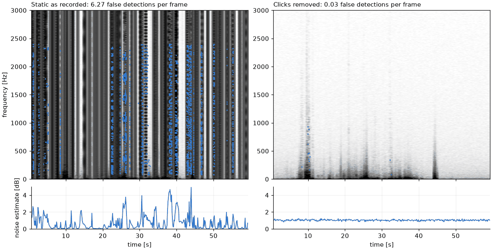

# How it works

Where the pipeline departs from the published method, and how its newer
stages work. For the method itself see
[Raab et al. 2022](https://doi.org/10.3389/fnint.2022.965211).

## Differences to the original implementation

The detection and tracking algorithms follow Raab et al. (2022). The tracker
is a numba port that reproduces the original `freq_tracking_v6` assignments
exactly in compatibility mode (verified in the test-suite), while being roughly 25× faster and
linear in recording length. Deliberate changes:

* **Harmonic exclusivity** – the original rejects a fish if *any* of its up to
  8 harmonics coincides with a peak of an already accepted fish. Because the
  harmonic tolerance grows with the harmonic number, high harmonics of one
  fish regularly capture a harmonic of another, which makes that fish
  disappear. By default only the `min_group_size` lowest harmonics are now
  exclusive (this still rejects in-range harmonics of other fish as ghosts).
  `exclusive_harmonics: all` restores the original behaviour.
* **Window-check bug** – when attaching a window's links to established
  identities, the original compared a detection's *position in the window*
  with the window's *frame count*, so the skipped span depended on the
  number of fish. It now checks the target's frame. In practice this rarely
  matters (on a 4 h recording it assigns ~100 more detections and changes no
  existing assignment); `track(..., v6_compat=True)` reproduces the original.
* **Interference removal** – new, see [below](#interference-removal).
* **Sub-bin frequencies** – fundamentals are refined by parabolic
  interpolation (`refine_frequency`), giving ~0.01 Hz precision instead of the
  0.61 Hz bin spacing.
* **Seamless blocks** – blocks are aligned to the STFT frame grid, so there
  are no edge artifacts or duplicate frames between blocks.
* Spectra are true PSDs (mlab `scale_by_freq` convention). They are 3 dB
  above the old hand-calibrated scale, which does not affect the
  noise-relative thresholds.

## Interference removal

Electrical interference often forms a *comb* of persistent lines at
consecutive multiples of a low fundamental (in the 2022 tube recordings:
95.4 Hz on all electrodes, plus 25, 55.5, 100 and 125 Hz combs). Each tooth's
harmonics are other teeth, so the harmonic-group detector cannot tell them
from fish. `wavetracker.interference` removes them before the channels are
summed. For every electrode and 60 s block it:

1. estimates the persistent spectrum: the 20th percentile over time, then
   the minimum over the last 5 blocks. A line must sit on the same bin for
   5 minutes.
2. finds lines ≥10 dB above a running-median noise baseline;
3. searches them for combs: spacing 20–300 Hz, at least 4 *consecutive* teeth
   within 0.3 Hz;
4. remembers every tooth found on an electrode for 30 minutes (single teeth
   intermittently fail the line test, which made the hum leak back), and
5. gates the remembered teeth: in each frame a tooth bin at or below the
   tooth's level (90th percentile + 3 dB, minimum over the history) is set to
   the noise floor; a bin above it contains a fish and is left untouched.

Where a fish overlaps a tooth (within the ~2 Hz main lobe), the gating can
split the fish's peak in two; two detections in one frame within 4 Hz with a
tooth between them are therefore merged into the stronger one. A strong fish
up to ~8 Hz away can also lift a tooth above the gate through its spectral
leakage, and the tracker then hands the fish's identity to the constant
tooth; a detection on a tooth with a stronger non-tooth detection within
8 Hz is therefore dropped.

The gate level is the minimum over the last 5 blocks. That protects fish
resting near a tooth but lags when the interference gets stronger, so some
hum still leaks as separate constant-frequency tracks (e.g. in the first hour
of 2022-06-02); `cleanup` discards them. `level_history_blocks: 2` follows the
interference faster at the cost of fish detections near teeth.

A fish is never a comb: its harmonics are spaced by its own fundamental
(≥ `min_freq`), and sub-multiples of it match only every 2nd/3rd tooth. So a
resting fish that is stable for hours and seen on a single electrode is kept
(tested with synthetic data). Gating rather than notching keeps a fish
visible while it passes a tooth, as long as it is stronger than the tooth.
The remaining blind spot is a fish that is **weaker than a tooth and stays
within ~1 Hz of it for 5+ minutes** on the same electrodes. At 0.6 Hz
resolution the two cannot be separated.

On the 4 h recording 2022-06-14 (no channel excluded) it removes the
interference detections (4.1 → 2.0 detections per frame for two fish) without
losing fish detections. The detected combs are listed in `wavetracker.json`
(`interference_combs`). It costs ~40 ms per 60 s block.

Because a stationary fish's harmonic series is itself a comb with spacing
equal to its fundamental, combs are only searched below
`interference.max_spacing`, by default `min(300, 0.9 × harmonic_groups.min_freq)`
(72 Hz for the default range, 300 Hz for 400–1200 Hz). A comb spaced wider
than the lowest fish frequency cannot be told apart from a resting fish and
is kept; restrict the fish range to remove it.

## Stitching

The rule-based stitching joins fragments when the learned linker is off
(`linking.enabled: false`, see [Learned linking](#learned-linking)).
The tracker breaks a track at every rise: the onset jump exceeds
`freq_tolerance` and, by the time the frequency has decayed back, the gap
exceeds `max_dt`. `wavetracker.stitching` joins fragment A to a later
fragment B when their *baselines* (10th percentile of the frequency, which
ignores the upward rises) agree:

| situation | condition |
|---|---|
| gap ≤ 30 s | baselines within 3 Hz; a clear rise onset (gap ≤ 2 s, jump ≥ +3 Hz) may differ by 6 Hz |
| dropout ≤ 15 min | baselines within 1.5 Hz and no other track at that frequency during the gap |
| overlap ≤ 30 s (double detection) | same median frequency during the overlap (2.5 Hz) |

Joins are made greedily, best first; frames that end up with two detections
of one identity keep the one closer to the track. An electrode amplitude
pattern check is available (`max_pattern_distance`) but off by default: in
the tube recordings it did not separate the two fish. With many fish close in
frequency (field recordings) lower `max_dropout`, e.g. to 60 s.

## Learned linking

In dense populations the tracker's fragments are almost always pure (one
fish), but each fish is spread over many of them: it breaks at rises, where a
fish is not detected for longer than `max_dt`, and next to close neighbours.
On the [dense-mixture benchmark](benchmarks.md#learned-fragment-linking),
joining every fragment to its true fish would raise IDF1 from 0.56 (the
rule-based stitching above) to 0.69 (lab noise); the linker reaches 0.64 at
the same purity. By default (`linking.enabled: true`), `wavetracker.linking`
replaces the stitching:

1. **Fragments**: every tracker identity with at least 10 detections,
   summarised at its start and end: frequency, slope and scatter, baseline
   (10th percentile), median, the electrode power pattern (short and long
   window, with its own scatter from split halves), the relative signs between
   electrodes (`cplx_v`) and the level.
2. **Candidates**: pairs (A, B) with B starting at most `max_gap` (180 s)
   after A ends, or overlapping it, whose junction frequencies, baselines or
   medians agree within `max_df` (5 Hz).
3. **Score**: a small neural network (2 hidden layers, 64 and 32 units)
   gives the probability that A and B are one fish, from 40 features of the
   pair: gap, overlap and shared frames, frequency jump and extrapolation
   errors, baseline and median differences, pattern distances and relative
   sign agreement, level change, how crowded the frequency is between them,
   the nearest other detection at both ends, and how the pair ranks among the
   competing candidates of A and of B. The weights
   (`wavetracker/models/linker.npz`) were trained on the benchmark's training
   mixtures (`benchmarks/dense/linker.py`), whose truth says which fragments
   belong to one fish.
4. **Association**: pairs are accepted most probable first, down to
   `threshold` (0.9), into identities (union-find), unless the two identities
   would share more than 5 % of their frames, or run at the same time (within
   0.3 s) at frequencies more than 3 Hz apart for more than 30 % of those
   detections (a fish is never at two frequencies at once).

The threshold sets the balance: higher thresholds keep identities purer and
leave more fragments. The features are measured in seconds and Hz, not in
frames or detections, and the model was trained on 9 and 2 electrodes and on
0.61 and 1.22 Hz resolution. The tube fish of the benchmark do not move, so
their electrode patterns are more stable than those of free-swimming fish.

## Recordings without fish

Field loggers start on the boat. For minutes the electrodes are out of the water,
then in empty water, and fish may come hours later, at dusk. Nothing estimated from
the start of a recording may be trusted, and noise must not make fish. Four things
went wrong here, each found on real deployments.

**Static is clicks.** Electrodes out of the water pick up clicks of a few
milliseconds, up to 40000 times the noise, about ten per second. One click in an FFT
window gives a smooth spectrum, so the noise estimate collapses (0.02 dB), and two
give an evenly spaced ripple, which is a harmonic series to the detector.
`wavetracker.clicks` removes them from the traces before the spectrogram:

1. Each channel is split by its spectrum over the block. Clicks are searched in the
   band above 20 % of the sampling rate, which fish do not reach, so that even a
   chirp right at an electrode does not look like one.
2. A click must reach 12 robust standard deviations of that band and lasts for as
   long as it stays above 8. Events longer than 0.5 s are real signals (a boat, rain).
3. Clicks are bridged by straight lines, but only in the part of the signal that does
   not stand out of the spectral floor. A hole in a loud fish is itself a click, of
   the fish's amplitude. In a hole, what stands out is scaled to what the samples
   around it hold, or a fish arriving later in the block would appear before it did.

Channels without clicks stay exactly as they are. `click_fraction` in
`wavetracker.json` tells how much was repaired, and the stored spectrograms show the
repaired traces. On 60 s of static 0.6 % of the samples change:

**Thresholds were frozen** from the first block. They now follow the median noise of
the 10 s around each frame (`threshold_window`), and cannot fall below what noise on
that many channels has, 0.77 dB on 16 channels. A frozen threshold could be wrong
either way: too low for the water if estimated in the air, too high for the rest of a
recording if estimated during crackle.

**Noise at low frequencies is not the noise of the high band.** Below about 1 kHz the
noise in the water is often common to all electrodes: 16 of them spread like one,
4.7 dB against 1.1 dB. Thresholds therefore also follow the noise over frequency
(`threshold_band`). It is measured as how much a bin changes between windows that do
not overlap, so that fish, which are stable, do not raise it even in a chorus. Bands
only ever raise thresholds, and not where the noise is the same over frequency.

**One stray detection could ruin the tracker.** The amplitude error distribution came
from the 30 s after the first detection. A lone false detection left it empty, which
removed the electrode pattern from every link of the recording: two crossing fish
became 23 identities with 118 swaps. It now comes from the first window with
detections in at least half of its frames. `track(..., v6_compat=True)` keeps the
original.

Results on real field recordings are in
[Benchmarks](benchmarks.md#recordings-that-start-without-fish): what a recording
starts with no longer changes what is found. This has a price. On clean lab recordings
fish lose about 0.5 % of their frames (up to 5 % after `cleanup` on one trial), and
where the water is noisy at low frequencies a fish near 150 Hz needs up to 10 dB more
than before; above about 650 Hz little changes. To reproduce results of earlier
versions, set `clicks.enabled: false`, `harmonic_groups.threshold_window: null` and
`harmonic_groups.threshold_band: null`.

## Known limitations / next steps

* The amplitude-error distribution used for tracking is estimated once, from the
  first window of `3 * max_dt` seconds with detections in half of its frames.
* The default threshold factors keep empty recordings clean, but miss weak fish in
  noisy water: on a 16-channel field grid they found 35 % of the fish of a night. Lower
  them for such recordings, see [field recordings](field-recordings.md).
* Static that lasts longer than `clicks.max_duration` without a pause stays.
* Fish within ±1 Hz of a mains harmonic (multiples of 50 Hz) are not detected
  (set `mains_freq: 0` if there is no mains).
* A fish needs harmonics 1..`min_group_size` unless
  `max_missing_harmonics` > 0. Groups with gaps are judged by the same
  greedy assignment; a fish with gaps whose 3rd harmonic coincides (within
  a bin) with a stronger fish is lost.
* `min_good_peak_power` is an absolute level whose meaning depends on the
  recording's gain; it is not derived from the data.
* Detection thresholds are relative to the global noise floor; in a dense
  chorus the troughs between fish are far above it, so thresholds have to be
  lowered by hand (see [field recordings](field-recordings.md)).
* Interference that is a single stationary harmonic series with a
  fundamental in the fish range (not a comb) is indistinguishable from a
  resting fish and is not removed.
* Gated comb teeth are set to the persistent noise baseline, which is a few
  dB below the median noise; they show as faint white lines in spectrogram
  plots.
* While a fish crosses a comb tooth its frequency estimate can be off by up
  to ~1 Hz (the merged detection is the stronger of two split peaks).
* Tracking runs on the CPU; for weeks of data with many fish it should be
  chunked/parallelized.
* [`merge-by-position`](post-processing.md#merging-by-position-moving-electrodes) resolves synthetic surveys correctly, but on the Iriri
  boat survey (~40 fish) it still leaves many small, ambiguous groups (352);
  filter its fish table by detection count, ambiguity and fit quality.
