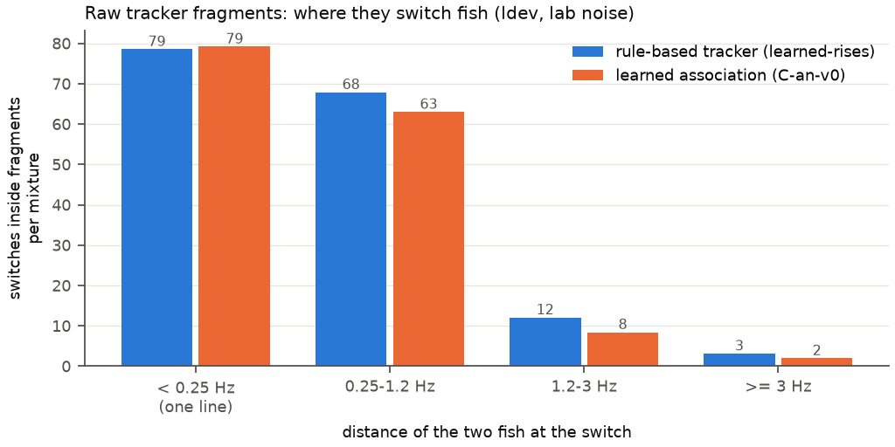
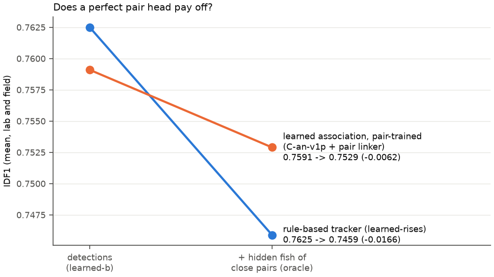
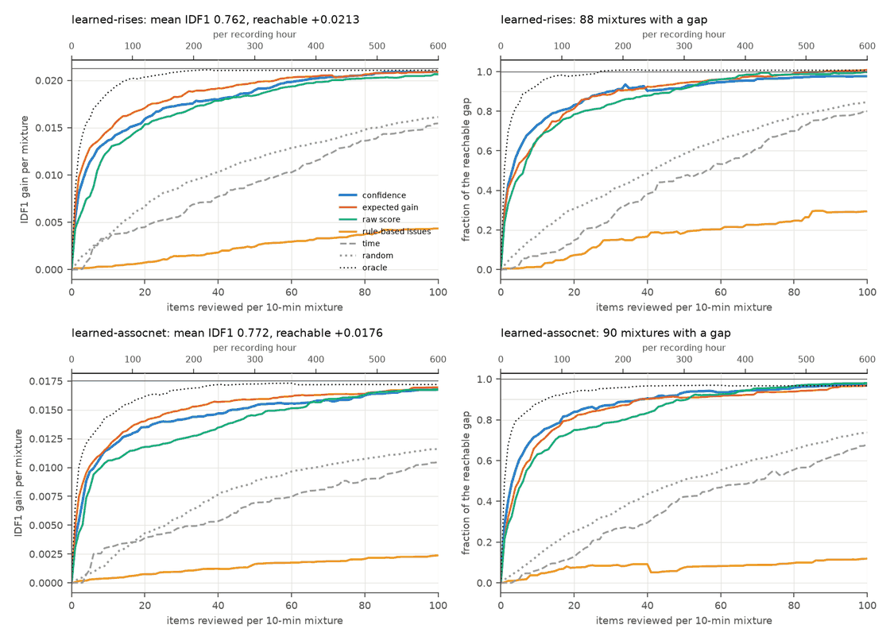

# Benchmarks

## Tube competition recordings

`benchmarks/tube_competition.py` scores results on the 2022 tube-competition
recordings (two fish per trial, no ground truth traces). It builds a
pseudo ground truth from the detections, independent of tracking, and reports
purity, fragmentation and coverage for the raw tracks and for `cleanup -n 2`
(see the module docstring for usage).

Results on 10 full 4 h trials (all six pairings) with the species range
`benchmarks/tube_competition.yaml` (400–1200 Hz), means over trials:

| | first rewrite | current |
|---|---|---|
| identities with ≥ 300 detections (truth: 2) | 32.2 | 9.9 |
| identities covering 90 % of the loser | 13.0 | 3.0 |
| largest track, winner / loser [% of frames] | 50 / 34 | 64 / 57 |
| after `cleanup -n 2`, winner / loser [% of frames] | 91 / 84 | 95 / 92 |
| purity (detections assigned to the right fish) | 1.000 | 1.000 |

Detection itself covers 95 % (winner) and 92 % (loser) of the frames; the rest is
mostly rises, which leave the pseudo-ground-truth band. Remaining
fragmentation is concentrated in losers with many rises (pairing 4a: 79 %
after cleanup).


Tracks of a rise-heavy trial before and after `cleanup -n 2` (successive
identities of one fish alternate light/dark):


## Recordings that start without fish

Results for a fish must not depend on what a recording starts with.
`benchmarks/fish_free_start.py` puts real fish-free data in front of a real recording
with fish, and compares the fish one to one with the recording alone, so that no
ground truth is needed.

The deployment below (16 channels, 48 kHz, `min_group_size: 2`, no absolute power
limit, no mains) was started at 11:18, and fish come at dusk, around 19:00. The first
measure is the part of 262 minutes of fish tracks in 2.5 h of night that is detected,
the fish taken from the most sensitive run. The night is analysed alone, after the 8 h
of day, and after 10 min of real static:

| threshold factors | fish found, before: alone / day / static | after |
|---|---|---|
| 6 and 10 (default) | 2 / 100 / 93 % | 35 / 35 / 35 % |
| 4 and 7 | 21 / 93 / 88 % | 76 / 77 / 76 % |
| 3 and 5 | 62 / 89 / 86 % | 92 / 92 / 92 % |

Before, the result depended on the noise of the first block. The price of that
sensitivity in the empty day and in the static, per frame:

| threshold factors | false detections, before: day / static | after |
|---|---|---|
| 6 and 10 (default) | 3.3 / 3.6 | 0.02 / 0.02 |
| 4 and 7 | 13 / 8.5 | 0.17 / 0.27 |
| 3 and 5 | 29 / 24 | 1.4 / 5.5 |

With factors 4 and 7, before and after:


The night's tracks of 30 s or more number 50 alone, 53 after the day and 55 after the
static, and 87 % of them stay one identity. Before they numbered 24, 604 and 2055.
Fish-free recordings, at the default settings:

| 35 to 70 min, no fish | detections per frame | identities |
|---|---|---|
| static | 2.83 → 0.01 | 6400 → 23 |
| quiet, then in the water | 1.65 → 0.02 | 1850 → 63 |
| quiet, then in the water | 0.58 → 0.03 | 1290 → 128 |
| in the water, with noise bursts | 1.13 → 0.01 | 2273 → 25 |

What it costs, on recordings with fish:

| | before | after |
|---|---|---|
| tube trials (8), fish detected, winner / loser [% of frames] | 96.1 / 92.0 | 95.6 / 91.4 |
| ... after `cleanup -n 2` | 95.0 / 91.4 | 94.4 / 91.0 |
| ... identities | 485 | 186 |
| ... purity | 1.000 | 1.000 |
| Iriri chorus, detections per frame | 60.4 | 57.7 |
| runtime of a 4 h tube trial [s] | 62 | 67 |

The worst single tube trial lost 5 points after cleanup (6a, winner, 96.3 to 91.1 %),
others gained up to 6 (6c, winner). Two settings are trade-offs, measured there. A
click threshold of 8 finds more of the night's fish at 4 and 7 (81 % of a stretch
against 58 %), but broke the tracks of 2 of the 16 lab fish apart. Stronger thresholds
over frequency remove more false detections in noise bursts at the cost of fish: on
the fish of that night, 0.7 instead of the 0.6 of `DetectionThresholds.BAND_SCALE`
lost 6 points of what is found without bands, and gained 0.01 per frame.

## Dense mixtures of tube recordings

`benchmarks/tube_mixture.py` (superseded by the
[dense mixtures](#dense-mixtures-with-power-augmentation) below) sums 8
two-fish tube recordings electrode by electrode. Each source is time-warped (frequency scale 0.4-1.6, plus a slow
drift common to all sources, std 0.5 % over ~5 min) so fish spread over
250-1300 Hz with natural modulations and harmonics land among other fish;
hum combs are removed first. Ground truth comes from tracking each source
alone. `benchmarks/harmonic_comodulation.py` scans the timescale,
`benchmarks/harmonic_rule.py` evaluates the rule per identity.

## Dense mixtures with power augmentation

`benchmarks/dense/` builds a benchmark of up to 30 fish from the two-fish
tube-competition recordings of 2019/20 (3x3 and 5x3 grids) and 2022 (1x11),
with ground truth, and lowers the power of single fish or of whole dyads to
emulate fish that are far from the electrodes. The data live outside the
repository, in `$WT_BENCHMARK_DATA` (default `~/wrk/data/wavetracker_benchmark`),
so that every worktree uses the same files.

```bash
python benchmarks/dense/library.py --plot        # 1. sources: track each trial alone
python benchmarks/dense/mixture.py --worker 0/2  # 2. lab mixtures (and --worker 1/2)
python benchmarks/dense/noise.py calibrate       # 3. field noise: level from real fish
python benchmarks/dense/noise.py derive          #    field-noise variants of every mixture
python benchmarks/dense/run.py track --tag mine -c my_config.yaml --split dev
python benchmarks/dense/run.py track --tag mine -c my_config.yaml --split dev-field
python benchmarks/dense/run.py report --tags default mine   # 4. figures, dev and dev-field
python benchmarks/dense/specs.py                 # table and figure of all mixtures
python benchmarks/dense/gallery.py               # spectrograms with the truth
```

A 30-fish mixture needs about 6.5 GB of memory to generate (and a GPU); run
each worker under a memory cap, e.g. `systemd-run --user --scope -p
MemoryMax=10G uv run python ...`, and not more workers than memory allows.

**Sources.** Every trial with two fish at least 20 Hz apart is analysed
alone for 20 min with the species range (400-1200 Hz), which is the reliable
case. Detections are assigned to the lower and the upper fish by two coarse
traces (dominant frequency peaks in 10 s windows); identities carry the
assignment through rises; isolated detections (fewer than 3 of the same fish
within 1 s and 2 Hz: hum, noise) are dropped.

**Complete truth.** Detections are not the fish: on lab recordings the
tracker leaves 6 % of the frames of a fish empty on average and up to 40 %
for single fish, mostly during rises and where a fish sits on a mains
harmonic (which detection excludes). Every gap of a fish's detections is
therefore bridged by following its ridge in the electrode-summed spectrogram
(wavetracker's frames and resolution) with dynamic programming, from the last
to the next detection, in a band from 6 Hz below to 40 Hz above the
interpolated track (rises), never within 4 Hz of the other fish and not on
hum teeth or stationary lines away from the fish. A frame is kept if the
ridge is at least 6 dB above the local floor and within 25 dB of the
detections around the gap, and if the path is continuous there. The truth
then covers 99.9 % of the frames (worst fish 97 %), so that completeness,
the fraction of a fish's frames with a detection, can be scored.

A source is kept if the ratio of its two fish frequencies matches the trial
metadata within 3 % (the metadata EODfs are temperature corrected, their
ratio is not), the two traces are closer than 3 Hz in less than 1 % of the
frames (not two traces on one fish), and at least half of each fish was
detected (completion follows hum as readily as a fish where there is little
to anchor it): 52 of 56 trials. Trials are split by fish group: 2019 groups 5
and 6 and the 2022 pairings 5 and 6 are the **test** pool (22 sources), all
others **dev** (30), so no individual of the test mixtures is seen while
developing. Contact sheets of all sources, detected and completed truth:
`$WT_BENCHMARK_DATA/figures/library_*.png`.

**Splitting a source into its fish.** In a short-time Fourier transform
(0.82 s, 75 % overlap) the bins within a few Hz of every harmonic of a fish's
trace belong to that fish (wider where the trace moves fast or is unknown).
In the masks a fish takes only what stands out of the noise (spectral
subtraction with over-subtraction 4), and the residual is filled with noise
of the local level there: the transform of white noise, shaped by the noise
spectrum away from the fish and by its changes over time in 200 Hz bands.
Stationary lines (hum teeth, crosstalk lines 4 dB above their surroundings)
are replaced by that noise. Near a fish, power in the residual more than
7.8 dB above the noise (chirp smears, a fish line off its trace) moves to the
fish. The parts add up to the source exactly (except at the lines), the noise
under a fish stays in the residual (where it is scaled like all noise), and a
fish attenuated to nothing leaves the noise of the recording, not a hole and
not a ghost (leakage is 44 dB below the fish).

**Mixing.** Every source is time-warped, `tau(t) = start + a (t + D(t))`:
the scale `a` places its two fish in the band of the scenario (dyad centres
stratified over the band, so density is controlled), `D` is a slow drift
common to all sources. Fish keep their natural frequency modulations, rises,
chirps, waveforms and electrode patterns; for low fish (a down to 0.09) all
of these are slowed by 1/a. Each source's 9 best electrodes are mapped onto
the 9 mixture electrodes in random order. The residual of each source is
scaled by `sqrt(a / n_sources)`, which keeps the noise floor of the mixture
at that of one recording for any number of sources and any scale.

**Augmentation.** Per fish (or per dyad), in dB: a static offset, a linear
ramp (`ramp_db`), a slow Ornstein-Uhlenbeck wander, fades of a fish that
swims away and comes back, and a slow independent gain per electrode (the
pattern changes as the fish moves). `fraction` limits it to some fish or
dyads.

**Noise: lab and field.** Every mixture exists twice. The *lab* mixtures
(`dev/`, `test/`) keep the noise of the lab recordings, against which the fish
have 40-60 dB: what tracking can do when noise is not the problem. The *field*
mixtures (`dev-field/`, `test-field/`) add real fish-free noise from the empty
day of a 16-electrode logger grid in the Iriri (iriri01-grid01-dev03, fish
come at dusk): 10 min per mixture, none used twice, dev and test from
different hours, resampled to 20 kHz on a 3x3 block of the 4x4 grid, so that
the noise keeps its spectrum (rising towards low frequencies), its
correlation across electrodes (|r| about 0.7) and its events (clicks, bursts).
Its level is set by the EOD amplitude of a fish next to an electrode in both
systems: wavetracker's power at the fundamental on the best electrode, the
median of the lab fish against the 95th percentile of the 7 fish tracked in
20 min of the same deployment's night. A lab fish at 0 dB gain is then as far
above the field noise as a field fish next to an electrode, and the
attenuation of the scenarios is distance. The absolute numbers are those of
the field mixtures. Calibration: `figures/field_noise_calibration.png`.
Not included yet: the night of that deployment is 10-20 dB above the day
floor below 1.2 kHz, a chorus of many unresolved fish.

**Truth.** Per fish, on a 10 Hz grid: frequency (NaN where unknown), the
gain applied, and the SNR of its fundamental in the mixture (power at the
truth frequency over the noise floor at that frequency, both summed over
electrodes, at wavetracker's default resolution of 0.61 Hz). The noise floor
comes from mixing the residuals alone as well, and the fish and noise power
are stored, so that other floors can be put under the same fish. Full-power
fish have a median SNR of 44-52 dB in the lab mixtures and about 20 dB in the
field mixtures (10 % of their frames below 7 dB).

**Scenarios** (`benchmarks/dense/suite.yaml`, 10 min each, dev and test):

| scenario | fish | band [Hz] | augmentation |
|---|---|---|---|
| density-04/10/20/30 | 4-30 | 400-1100 | none |
| crowded-30 | 30 | 550-850 (nearest neighbour 4 Hz, median) | none |
| lowonly-10 | 10 | 70-300 | none |
| lowfreq-30 | 30 | 60-1300, log | none |
| atten-fish-30 | 30 | 150-1300, log | every fish: static 0 to -40 dB, wander, fades 10-40 dB, electrode drift |
| atten-dyad-30 | 30 | 150-1300, log | half the dyads at -15 to -45 dB, fades, electrode drift |
| ladder-10/30 | 10, 30 | 300-1300 / 150-1300 | every fish ramps by 60 dB, in or out |

**Scoring** (`benchmarks/dense/score.py`). Detections are matched one to one
per frame to the truth (within 2 Hz). *Completeness* (recall) counts the
frames of a fish with a matched detection, also only over the frames on which
the fish is at least 6 dB above the floor of the mixture (*visible*);
coverage counts those of its dominant identity, IDF1 assigns identities one
to one to fish (what a user wants: one identity per fish).
Unmatched detections are *harmonic* (on a harmonic or subharmonic of a fish)
or *false*; near a fish whose truth is unknown they are ignored. Every
(fish, frame) is saved with its SNR, gain, frequency and the distance to the
nearest line of another fish, for the curves in the report.

Spectrograms and truth of a lab mixture, the same fish in field noise, and a
ladder (every fish ramps by 60 dB; light: low SNR):


**Baseline** (wavetracker defaults, and the dense-population settings of
`benchmarks/dense/configs/dense.yaml`: grid factors 4/7, `min_group_size: 2`,
stricter links and stitching), dev split, field noise, means over seeds:

| scenario | completeness, default / dense | ... of visible frames, dense | IDF1, default / dense | precision, dense | switches per fish and min, dense |
|---|---|---|---|---|---|
| density-04 | 0.99 / 0.99 | 0.99 | 0.99 / 0.99 | 0.98 | 0.25 |
| density-10 | 0.76 / 0.92 | 0.92 | 0.63 / 0.70 | 0.99 | 1.0 |
| density-20 | 0.67 / 0.86 | 0.92 | 0.68 / 0.70 | 0.98 | 1.3 |
| density-30 | 0.58 / 0.74 | 0.80 | 0.61 / 0.61 | 0.96 | 0.8 |
| crowded-30 | 0.53 / 0.71 | 0.76 | 0.53 / 0.59 | 1.00 | 1.0 |
| lowonly-10 | 0.47 / 0.79 | 0.83 | 0.64 / 0.76 | 0.97 | 0.13 |
| lowfreq-30 | 0.42 / 0.67 | 0.75 | 0.53 / 0.63 | 0.83 | 0.42 |
| atten-fish-30 | 0.13 / 0.22 | 0.73 | 0.18 / 0.22 | 0.74 | 0.44 |
| atten-dyad-30 | 0.29 / 0.40 | 0.79 | 0.40 / 0.37 | 0.84 | 0.42 |
| ladder-10 | 0.14 / 0.22 | 0.83 | 0.23 / 0.31 | 0.85 | 0.35 |
| ladder-30 | 0.11 / 0.20 | 0.74 | 0.19 / 0.25 | 0.79 | 0.33 |

In lab noise the dense settings reach 0.83 completeness and IDF1 0.68 on
density-30 (defaults 0.69 and 0.70), but their thresholds then pick up
harmonics: 14 harmonic detections per frame on lowfreq-30 (precision 0.62).
What limits tracking, in field noise:


* **Density, not noise, costs completeness first.** Already at lab SNR
  completeness falls from 0.99 with 4 fish to 0.69 (defaults) or 0.83 (dense)
  with 30, although every fish is 40-60 dB above the noise. Strong fish
  within 1 Hz of another fish's line are found in under half of their frames,
  within 1-3 Hz in two thirds, farther away in all of them (two fish that
  close make one spectral peak at 0.61 Hz resolution).
* **Identities break more than detections fail.** With 10 or more fish, a
  fish's frames on its one identity (dashed) are 10-25 points below its
  detected frames; fish change identity about once per minute with the
  dense settings, mostly at rises and at close neighbours.
* **SNR**: half of a fish's frames are found at about 8 dB SNR of the
  fundamental with the dense settings and about 15 dB with the defaults.
  Moved away from a near-electrode position, a fish has lost half of its
  detected frames at 14 dB attenuation (dense, 0.80 to 0.40; defaults at
  11 dB, 0.57 to 0.28) and four fifths at 19 dB. Of the frames still visible
  (>= 6 dB), the dense settings find 73-83 % in the attenuation scenarios.
* **Low frequencies**: in field noise, fish below 150 Hz are found in a
  median 63 % of their frames with the dense settings (quartiles 37-81 %)
  and 12 % with the defaults, fish at 150-300 Hz in 87 % and 38 %, above
  300 Hz in 88 % and 78 %. Half of the fish in lowfreq-30 have another fish's
  line (a harmonic) within 1.4 Hz.
* Harmonics of strong fish tracked as fish are the main false detections
  (1.5-4 per frame in the attenuated and low-frequency scenarios, dense).

### Splits for the learned detector

A network trained on spectrogram crops of the training mixtures could learn
the individual fish (their harmonic spectra, chirps, rises, electrode
patterns) instead of what makes a fish, and then score well on mixtures of
the same fish. `dev` and the `train` split of the
[linker](#learned-fragment-linking) draw on the same dev sources, which is
fine for features of tracker fragments but not for a network that sees the
spectrogram. The learned detector therefore has two splits of its own, drawn
by fish group from the dev sources (`mixture.POOL`, `library.json`
unchanged); the test groups stay unseen:

| split | fish groups (dev sources) | trials | mixtures | field noise (`-field`) |
|---|---|---|---|---|
| `ltrain` | 2019 group 3, 2022 pairings 1-3 | 20 | 26 (`learned_train.yaml`) | the next day of the noise recording, 10:48-15:08, used by no other split |
| `ldev` | 2019 group 4, 2022 pairing 4 | 10 | 17 (`learned_dev.yaml`) | the dev hours, as `dev-field` |
| `ldev2` | 2019 group 4, 2022 pairing 4 | 10 | 34 (`learned_dev2.yaml`): the designs of `ldev`, new seeds ([below](#a-larger-development-set-ldev2)) | the dev hours, also shifted by 5 min |

`ldev` has the scenarios and seeds of `suite.yaml`. Its 10 trials are fewer
than the 15 sources of a 30-fish scenario, so a pool smaller than the design
uses every trial once and as few as needed a second time (5 in each 30-fish
mixture), each copy with its own frequency scale, offset and electrode
order; such a fish appears twice, at different frequencies. Splits with
large enough pools draw exactly as before (the sources of all 53 dev, test
and train mixtures replay identically). `ltrain` covers the same families at
other densities and bands (6-30 fish, seeds 200 and 201). Its field noise
comes from the second day of the noise recording, 2026-09-06, which is as
empty as the first: in every other file from 09:38 to 16:18 no line stands
more than 0.4 dB above the floor of the 5-min mean spectrum, while the fish
of the night stand 7-12 dB above it (before 10:30 the floor is up to 30 dB
higher, so those hours are not used).

```bash
python benchmarks/dense/mixture.py --suite benchmarks/dense/learned_dev.yaml
python benchmarks/dense/mixture.py --suite benchmarks/dense/learned_train.yaml
python benchmarks/dense/noise.py derive --splits ldev ltrain   # ldev-field, ltrain-field
python benchmarks/dense/run.py track --tag classic-ldev -c benchmarks/dense/configs/dense-linked.yaml --split ldev   # and ldev-field
```

**Classic baseline** (run tag `classic-ldev`): the dense settings with the
linker (`configs/dense-linked.yaml`), wavetracker b833de9, means over seeds,
lab / field noise:

| scenario | IDF1 | recall | recall, detected frames | false per frame | harmonic per frame | false identities >= 30 s |
|---|---|---|---|---|---|---|
| density-04 | 0.87 / 0.86 | 0.80 / 0.79 | 0.79 / 0.78 | 0.03 / 0.03 | 0.0 / 0.0 | 0 / 0 |
| density-10 | 0.90 / 0.83 | 0.87 / 0.85 | 0.88 / 0.85 | 0.02 / 0.02 | 0.0 / 0.0 | 0 / 0 |
| density-20 | 0.80 / 0.78 | 0.76 / 0.74 | 0.76 / 0.75 | 0.02 / 0.02 | 0.0 / 0.0 | 0 / 0 |
| density-30 | 0.83 / 0.78 | 0.80 / 0.74 | 0.80 / 0.74 | 0.12 / 0.16 | 0.1 / 0.5 | 0 / 0 |
| crowded-30 | 0.62 / 0.60 | 0.63 / 0.62 | 0.63 / 0.62 | 0.03 / 0.03 | 0.0 / 0.0 | 0 / 0 |
| lowonly-10 | 0.84 / 0.76 | 0.93 / 0.64 | 0.93 / 0.63 | 0.92 / 0.01 | 2.2 / 0.0 | 5 / 0 |
| lowfreq-30 | 0.71 / 0.67 | 0.77 / 0.70 | 0.77 / 0.69 | 0.33 / 0.27 | 8.6 / 6.6 | 28 / 15 |
| atten-fish-30 | 0.48 / 0.40 | 0.36 / 0.30 | 0.36 / 0.30 | 0.60 / 0.50 | 2.9 / 2.6 | 8 / 5 |
| atten-dyad-30 | 0.53 / 0.50 | 0.48 / 0.46 | 0.48 / 0.46 | 0.12 / 0.43 | 5.3 / 5.5 | 17 / 18 |
| ladder-10 | 0.42 / 0.40 | 0.31 / 0.30 | 0.31 / 0.30 | 0.55 / 0.52 | 1.5 / 1.5 | 2 / 2 |
| ladder-30 | 0.35 / 0.30 | 0.27 / 0.21 | 0.26 / 0.20 | 0.45 / 0.28 | 3.6 / 3.0 | 12 / 8 |
| **mean of the 17 mixtures** | **0.639 / 0.597** | **0.605 / 0.551** | 0.604 / 0.549 | 0.28 / 0.23 | 2.6 / 2.2 | 8.1 / 5.5 |

The same settings reach IDF1 0.641 / 0.613 and recall 0.673 / 0.569 on
`dev`. `ldev` is harder in lab noise because its fish are weaker: six of the
seven 2019 group 4 recordings put their fish only 20-25 dB above the lab
noise of a mixture (median SNR of all fish frames 18 dB, against 28 dB on
`dev` and 40 dB on `test`); in field noise the splits are alike (13 and
14 dB). The `ltrain` fish are strong (38 dB in lab noise, no unattenuated
fish below 20 dB, against a third of them in `ldev`), so in training weak
fish come from the attenuation scenarios and the field noise. The learned
detector is compared against these numbers, on the same splits.
Figures: `$WT_BENCHMARK_DATA/figures/summary_classic-ldev_ldev_ldev-field.png`
and `curves_classic-ldev_ldev*.png` (`run.py report --tags classic-ldev
--splits ldev ldev-field`).

## Learned detector (v1)

`detector.method: learned` (`wavetracker/salience.py`) replaces peaks and
harmonic groups with a small convolutional network: the electrode-summed
spectrogram, normalised per frame in 100 Hz bands, goes in as a harmonic
stack (channel h at candidate bin k is bin h*k, for h = 1/3, 1/2, 1..5); six
convolution layers (32 channels, about 81k parameters) with time dilations
see +-7 Hz and +-5 s; the output is a salience (probability of a
fundamental) and a sub-bin offset per bin. Peaks above `detector.threshold`
become detections; tracker and linker are unchanged.

Training (`benchmarks/dense/salience_train.py --tag v1`, 5000 steps of 8
crops, 78 min on an RTX 4080): crops of the 26 `ltrain` mixtures with their
field noise mixed in at a random gain (0 = lab, 1 = the field variant, up to
3; the truth's fish and noise powers give the SNR at any gain), random
electrode subsets, Gaussian targets (sigma 0.6 Hz) at the truth
fundamentals; ignored in the loss: fish frames below -3 dB, stretches the
truth does not know and persistent lines that are no truth fundamental or
harmonic (found on the lab variant); ridge-completed frames at half weight;
harmonics of truth fish are negatives. The model is packaged as
`wavetracker/models/salience.pt`; `configs/learned-linked.yaml` is
`dense-linked.yaml` with the learned detector.

On `ldev` (17 mixtures each, same tracker and linker; `strata.py`), the
threshold 0.6 is best for lab and field noise alike (0.4-0.7 tried):

| | IDF1 | recall | precision | harmonic/frame | false ids >= 30 s |
|---|---|---|---|---|---|
| classic, lab | 0.639 | 0.605 | 0.832 | 2.65 | 8.1 |
| learned, lab | **0.727** | 0.686 | 0.958 | 0.31 | 1.8 |
| classic, field | 0.597 | 0.551 | 0.843 | 2.23 | 5.5 |
| learned, field | **0.711** | 0.667 | 0.954 | 0.40 | 2.2 |

IDF1 is higher in every one of the 17 mixtures (lab and field); detection
takes 1.1 s instead of 2.2 s per 10-min, 9-electrode mixture. Recall by
failure mode (lab / field):

| | classic | learned |
|---|---|---|
| fish at 0-6 dB | 0.04 / 0.13 | 0.32 / 0.58 |
| fish at 6-20 dB | 0.66 / 0.71 | 0.83 / 0.88 |
| visible fish, nearest line < 1.2 Hz | 0.62 / 0.63 | 0.66 / 0.68 |
| visible fish, nearest line 1.2-3 Hz | 0.69 / 0.67 | 0.81 / 0.85 |

Faint fish and false lines move most; pairs closer than the window's
resolution (about 1.2 Hz for 1.64 s Hann windows) barely, as expected for a
detector that sees only the summed spectrogram. A ByteTrack-style start
(`tracking.start_salience`) did not help: with detections at 0.4-0.5 and
starts at 0.7, IDF1 was 0.68-0.70 on lab against 0.72 for a plain 0.7
threshold, since weak detections still link into existing identities.
Some remaining "false" identities are long, stationary lines, e.g. near
810 Hz through `ldev/ladder-30-s0`, probably real lines the truth does not
know.

Figures: `figures/strata_learned_v1.png`, `figures/curves_classic-ldev_s5000-t0.6_ldev.png`
(and `_ldev-field`), `figures/tracks_s5000-t0.6_ldev_ladder-30-s0.png`.

### What limits v1 (step A)

All on `ldev` / `ldev-field` (lab / field noise), same tracker and linker
unless stated; IDF1 is the mean over the 17 mixtures of each.

**Ceilings** (`benchmarks/dense/oracle.py`; figure `figures/A-ceilings.png`):

| | IDF1 |
|---|---|
| classic | 0.639 / 0.597 |
| classic detections, truth identities | 0.729 / 0.684 |
| learned v1 | 0.727 / 0.711 |
| learned v1 detections, truth identities | 0.790 / 0.775 |
| truth detections >= 0 dB, real tracker + linker | 0.775 / 0.740 |
| truth detections >= 0 dB, truth identities | 0.887 / 0.843 |

What is left to v1 (0.16 / 0.13 up to what is above the noise) is split
about evenly: detection 0.07 / 0.05, association 0.09 / 0.08 (average of the
two orders of fixing). Most of the association loss is the tracker's own
fragments mixing close fish (purity 0.95 with perfect detections; truth
detections reach only 0.53 / 0.63 IDF1 on `crowded-30`) and joins the
linker cannot make; the linker's decisions cost 0.016, tracker parameters
nothing (12 settings within +-0.005; `max_dt` 5 is as good and 2.6x faster).
The linker retrained on learned fragments of `ltrain` gives +0.011 at a
link threshold of 0.7 (model in `$WT_BENCHMARK_DATA/salience/`, not
packaged).

**Capacity, data and seed** (5000 steps each, best of thresholds 0.5-0.7):

| model | IDF1 |
|---|---|
| 32 channels, 26 mixtures (v1) | 0.727 / 0.711 |
| 32 channels, 26 mixtures, seed 1 | 0.720 / 0.702 |
| 32 channels, 13 mixtures | 0.714 / 0.699 |
| 64 channels, 26 mixtures | 0.730 / 0.712 |
| 64 channels, 13 mixtures | 0.722 / 0.708 |

A different seed moves IDF1 by about 0.008; doubling the mixtures or the
width adds about as much each. The wider network detects better at the same
threshold (lab, 0.6: recall 0.700 vs 0.686 at precision 0.965 vs 0.958;
recall with a line 1.2-3 Hz away 0.849 vs 0.813), but IDF1 hardly follows:
association limits it as much as detection. The halved data are fewer
mixtures of the same 20 trials, not fewer fish.

**Recording edges.** Without context at the start and end of a recording,
v1 padded with zeros and gave bursts of false detections there (46-60
identities per 5-minute field file); the context is now mirrored from the
data (precision 0.958 -> 0.964, IDF1 +0.001 on `ldev`; edge identities in
field files 0-2). With the mirrored edges and the retrained linker, v1
reaches 0.739 / 0.723.

**Real field recordings** (`benchmarks/field_check.py`, no truth): on four
night files of the 16-electrode grid `iriri01-grid01-dev03` and the
2-electrode boat take `DR0000_0209`, the learned detector follows faint
fish the classic one misses or fragments (identities >= 30 s per grid file
15/16/13/8 vs 7/11/8/2) and leaves fewer stray detections in noise bursts.
Open problems seen there: a strong 308 Hz fish on the boat take detected in
19 % of its frames (classic 60 %), and occasional harmonics reported as a
second fish. Figures: `figures/field_side_by_side/`.

### Association for the learned detector (step B)

With the detections of learned v1 fixed, `benchmarks/dense/assoc_diag.py`
compares the tracker's raw fragments with the truth: where a fragment
switches fish, where a fish's fragments break, and what each situation costs
(details and all experiments: `benchmarks/dense/association_notes.md`).
Of the 0.051 / 0.052 IDF1 between v1 and its truth identities, joining the
fragments costs 0.030 / 0.031 (the linker refusing joins at rises, missing
candidates for rise onsets, and its threshold), switches inside fragments
0.012 / 0.011 (78 % at crossings, half of them where the two fish are one
line, which no tracker can get right), and harmonic and false detections
inside identities 0.008 / 0.009. With truth detections, crossings dominate
(0.05).

`configs/learned-assoc.yaml` combines what helped: the tracker's motion model
(`tracking.motion_window: 2`, see
[algorithms](algorithms.md#following-the-frequency-slope-motion-model)), a
linker retrained on that tracker's `ltrain` fragments (threshold 0.6),
looser shared-frame and parallel rules in the linker's association
(`max_shared` 0.3, `max_parallel` 0.6: both refused mostly true joins at
rises), and dropping identities whose mean salience is below 0.75
(`tracking.min_identity_salience`):

| | IDF1 | purity | false ids >= 30 s | switches / fish / min |
|---|---|---|---|---|
| v1, `learned-relinked.yaml` | 0.739 / 0.723 | 0.981 / 0.981 | 1.6 / 1.9 | 0.43 / 0.46 |
| v1, `learned-assoc.yaml` | **0.750 / 0.737** | 0.980 / 0.983 | 0.9 / 0.9 | 0.26 / 0.29 |
| truth detections >= 0 dB, `dense-linked.yaml` | 0.775 / 0.740 | 0.954 / 0.956 | 0 / 0 | 1.82 / 1.67 |
| the same + motion model and association rules | **0.790 / 0.757** | 0.955 / 0.959 | 0 / 0 | 1.43 / 1.29 |

It is better in 15 / 13 of the 17 mixtures (lab / field) and worse in 1 / 0.
The motion model keeps crossing fish apart (with truth detections, frames
with a neighbour within 3 Hz on their fish's identity: +0.03-0.04), but for
learned detections it needs the retrained linker. Tracking takes twice as
long. Figures: `figures/assoc_diagnosis.png`, `figures/assoc_results.png`,
`figures/strata_assoc.png`.

### Detector and association together (step B)

The detector track (`salience_train.py` options `--temporal-dilations`,
`--channels`, augmentations; `det_sweep.py`; notes in
`$WT_BENCHMARK_DATA/salience/B-det-NOTES.md`) added a temporal stack to the
network: 7 residual layers along time per frequency bin (dilations 1-64,
about 52 s of context) on a trunk of width 64. Training is 4x faster (data
prepared on the GPU). Through the step-A tracker and linker, two seeds give
mean IDF1 (lab and field) 0.742 against 0.730 for v1, best at threshold 0.7.
Most misses near close lines are a decoding limit: two fundamentals one bin
apart give one peak.

Through the step-B association (`configs/learned-assoc.yaml`), mean IDF1 of
lab and field, best of thresholds 0.6 / 0.7:

| detector | seed 0 | seed 1 | harmonic/frame | false ids >= 30 s |
|---|---|---|---|---|
| v1 (association only) | 0.744 | | 0.28 / 0.37 | 0.9 / 0.9 |
| temporal stack | 0.746 | 0.751 | 0.31 / 0.40 | 1.1 / 1.5 |
| temporal stack + augmentations | 0.747 | 0.743 | 0.11 / 0.18 | 0.5 / 0.6 |

(harmonics and false identities lab / field, seed 0, threshold 0.6.) The
augmented model (speed perturbation 0.85-1.18, spectral tilt, hard negatives
at 1/5-5 times strong fish, harmonic channels 1/5 ... 5) is as good in IDF1
and much cleaner: a third of the harmonic detections, half the false
identities, at slightly lower recall of faint fish. On the field grid it no
longer reports the 2nd harmonic of a masked fish as a fish. The seed spread
(about 0.005) is now as large as the differences: further decisions need
more seeds or a larger dev split ([`ldev2`](#a-larger-development-set-ldev2)).
`configs/learned-b.yaml` is the candidate
(augmented model, seed 0, threshold 0.6): 0.752 / 0.741, against classic
0.639 / 0.597 and v1 at the end of step A 0.739 / 0.723.

### Rises (step B)

With the detections of `learned-b.yaml` fixed (run `B-aug-s0-t0.6`) and,
to separate tracking from detection, with truth detections >= 0 dB
(`A-oracle-snr0` through `configs/oracle-b.yaml`, the same association with
the packaged linker at 0.9), `benchmarks/dense/rise_diag.py` finds the rises
in the truth (a jump of at least 2 Hz within 1 s that stays above half its
size for 2 s, so chirps are left out; it ends when the frequency is back
within 20 % of the jump, after at most 60 s or at the next onset) and checks
each fish's identities there. `ldev` holds 1100 rises (65 per mixture; size
quartiles 3.8 / 5.8 / 9.9 Hz, 99 % below 34 Hz, the largest 61 Hz; half the
jump decays in a median 6 s). The cost of an outcome is the IDF1 gained by an
oracle that repairs only those rises (joins every identity mostly of the fish
during the rise to the one it had before, and moves its other detections
there). Per mixture, lab / field noise:

| outcome | learned: rises | cost | truth detections: rises | cost |
|---|---|---|---|---|
| kept by the tracker | 14.9 / 14.3 | 0.003 / 0.001 | 18.4 / 17.8 | 0.001 / 0.001 |
| kept by the linker | 12.2 / 10.8 | 0.000 / 0.000 | 13.2 / 13.1 | 0.000 / 0.000 |
| on own identities, never joined | 10.0 / 12.6 | **0.024 / 0.031** | 12.1 / 9.5 | 0.010 / 0.007 |
| onto another fish's identity | 2.9 / 3.4 | 0.001 / 0.002 | 5.2 / 5.2 | 0.005 / 0.004 |
| dropped (no identity) | 1.4 / 1.4 | 0.000 / 0.000 | 1.4 / 1.4 | 0.000 / 0.000 |
| fish not on its own identity before / not detected | 23.4 / 22.2 | | 14.5 / 17.7 | |
| **all rises** | | **0.025 / 0.032** | | 0.015 / 0.012 |

Rises cost three times what the [association diagnosis](#association-for-the-learned-detector-step-b)
gave them (0.008 / 0.009), which counted a break first as a crossing or a
gap: a 10 Hz rise among 30 fish crosses other lines. The fish whose rises
break are mostly in the density scenarios (0.056 / 0.071 there), where a fish
with many rises ends on two identities that take turns at every rise. With
learned detections 60 % of the unjoined breaks jump more than 5 Hz (beyond
the linker's candidates) across a median 0.66 s; with truth detections 44 %
jump less than 2 Hz across one frame (the climb is faster than the tracker's
0.5 Hz gap tolerance). Identities hold 51 % of the fish's frames within
+-30 s of an onset, against 65 % elsewhere.

**Rise joiner** (`rises.enabled`, [algorithms](algorithms.md#joining-across-rises)):
an identity that stops is joined to one that starts within 5 s (or up to 4 s
before), 1.5-35 Hz higher, with the same electrode pattern. On candidate
pairs of `ldev` (a stop and a start, 1.5-100 Hz apart), the pattern
separates one fish from two (rms difference median 3.7 vs 8.9 dB,
correlation 0.89 vs 0.01); the jump helps (8.6 vs 46 Hz), the decay does not
(slope of the later piece -0.24 vs -0.07 Hz/s, but requiring a falling slope
lost IDF1: many rise pieces end, or the next rise starts, before they
decay). A gradient-boosted classifier of 14 pair features trained on the
`ltrain` candidates was no better than the rules (+0.021 / +0.023 at best).
The learned detector reports the old frequency for 1-3.5 s after an onset (a
ghost tail; its temporal stack sees +-26 s), and the new one up to a second
before it, so the old identity stops after the new one starts: allowing 4 s
of overlap, and dropping the old identity's tail on a join, took the field
gain from +0.016 to +0.021. With truth detections the patterns of fish near
the noise are noise and chained faint fish together (`ladder-30-s0` -0.038);
both sides now need a mean salience of 0.4, which the learned detector
(threshold 0.6) always has.

`configs/learned-rises.yaml` (`learned-b.yaml` + `rises.enabled`), lab /
field noise, means of 17 mixtures:

| | learned-b | learned-rises | truth det., oracle-b | + rise joiner |
|---|---|---|---|---|
| IDF1 | 0.752 / 0.741 | **0.773 / 0.762** | 0.790 / 0.757 | 0.795 / 0.761 |
| mixtures better / worse | | 15 / 0, 15 / 0 | | 14 / 0, 13 / 0 |
| purity | 0.980 / 0.981 | 0.979 / 0.980 | 0.955 / 0.959 | 0.953 / 0.957 |
| switches per fish and minute | 0.28 / 0.32 | 0.22 / 0.26 | 1.43 / 1.29 | 1.35 / 1.22 |
| false identities >= 30 s | 0.47 / 0.59 | 0.47 / 0.59 | 0 / 0 | 0 / 0 |
| identities >= 30 s | 24.5 / 24.6 | 22.4 / 22.5 | 30.7 / 29.1 | 29.3 / 27.8 |
| identity coverage within +-30 s of rises | 0.51 / 0.51 | 0.58 / 0.58 | 0.61 / 0.59 | 0.63 / 0.60 |
| IDF1 crowded | 0.745 / 0.746 | 0.760 / 0.762 | 0.626 / 0.643 | 0.649 / 0.654 |
| IDF1 density | 0.895 / 0.875 | 0.946 / 0.924 | 0.929 / 0.924 | 0.935 / 0.929 |
| IDF1 atten (+ ladder) | 0.587 / 0.583 | 0.595 / 0.592 | 0.666 / 0.596 | 0.666 / 0.596 |
| IDF1 lowfreq (+ lowonly) | 0.903 / 0.884 | 0.910 / 0.891 | 0.957 / 0.930 | 0.962 / 0.937 |
| rise cost left (oracle repair) | 0.025 / 0.032 | 0.004 / 0.011 | 0.015 / 0.012 | 0.011 / 0.009 |

Detections are fixed, so recall and precision do not change. The joiner
makes 5.6 / 6.0 joins per mixture; 0.47 / 0.59 of them join identities of
two different fish (8 % / 10 %; one in ten of those are the two fish of one
tube recording), mostly in `crowded`, where purity falls by 0.009-0.014 while
IDF1 still rises. With truth detections, 29 % / 19 % of its 5.4 / 4.5 joins
per mixture are wrong, again mostly in `crowded`: fish a few Hz apart share
spectrogram bins and so read the same electrode pattern. What is left at rises with learned detections: in field
noise mostly fish whose pattern changes within seconds (they move) and
identities that run in parallel with others (shared frames). `min_jump` 3
instead of 1.5 Hz trades a little IDF1 for a little purity (learned 0.772 /
0.762, truth detections 0.795 / 0.760). With the classic detector
(`classic-ldev` through `dense-linked.yaml`, detections without salience, so
`rises.min_salience: null`) the joiner adds +0.006 / +0.006 (13 / 12 of 17
better, 1 / 1 worse) at a purity cost of 0.004 / 0.008: its harmonic and
false lines offer more false joins.
`ldev/density-10-s0`, fish 2 (13 rises) goes from 4 identities to 1 (IDF1
of the mixture +0.12).

On `ldev2` (new seeds of the `ldev` designs; the 16 lab mixtures complete at
the time: `atten-fish`, `crowded`, `density-30`, `lowfreq-30`, seeds 100-103;
detections `B-rise-l2b` of the `learned-b` detector), `learned-rises.yaml`
confirms: IDF1 0.778 -> 0.796 (+0.018), better in 16 of 16, purity 0.970 ->
0.969, switches per fish and minute 0.39 -> 0.34, rise cost 0.029 -> 0.012,
identity coverage within +-30 s of rises 0.55 -> 0.61, 6.5 joins per mixture
of which 0.62 join two fish. A 2.5 s pattern window, which looked better in
`ldev-field` (two mixtures with moving fish), gives the same (+0.018). Figures: `figures/rises_B-rise-j3.png` (outcomes,
costs, IDF1 change per mixture), `figures/rises_example_ldev_density-10-s0_2.png`,
`figures/rises_example_ldev-field_density-10-s0_6.png` (ghost tail),
`figures/strata_rises.png`; notes in `$WT_BENCHMARK_DATA/assoc/B-rise-NOTES.md`.

### A larger development set (`ldev2`)

On 17 mixtures, a difference of 0.005 mean IDF1 between two detectors is
lost in the spread over mixtures: the paired 95 % CI of `learned-b.yaml`
against `learned-assoc.yaml` on `ldev` (lab and field) runs from -0.013 to
+0.016. `ldev2` (`learned_dev2.yaml`) has the designs of `ldev` with new
seeds, two for every `ldev` mixture (seeds 100-101 where `ldev` has seed 0,
100-103 where it has 0 and 1): 34 mixtures from the same 10 trials (the
30-fish mixtures use 5 of them twice, as in `ldev`). `ldev` + `ldev2` then
has 51 mixtures, 3 or 6 per scenario. The field variants (`ldev2-field`)
also take their noise from the dev hours. Those hold only 19 disjoint 10-min
segments, which `dev-field` and `ldev-field` already use, so `ldev2` first
takes the 18 segments shifted by 5 min and then 16 of the disjoint ones. No
5-min file is in more than two `ldev2` mixtures (the end of one, the start
of the other), and none comes from the test hours or the `ltrain` day. The
other splits are unchanged. Each variant takes 15 GB.

```bash
python benchmarks/dense/mixture.py --suite benchmarks/dense/learned_dev2.yaml
python benchmarks/dense/noise.py derive --splits ldev2
python benchmarks/dense/run.py track --tag mine -c my_config.yaml --split ldev2   # and ldev2-field
python benchmarks/dense/compare.py --a ref-learned-b --b mine   # ldev, ldev2, lab and field
python benchmarks/dense/compare.py --a classic-ldev --b B-aug-s0-t0.6:ldev,ref-learned-b:ldev2 --plot
```

`compare.py` pairs two runs mixture by mixture. It reports the mean
difference of a score (IDF1 by default, `--metric`), a bootstrap 95 % CI,
and how many mixtures are better or worse (lab and field counted apart):
overall, per split, for lab and field, and per scenario group. The bootstrap
resamples mixtures, each with its lab and field variant, because the two
hold the same fish and are far from independent. `--stratify` resamples
within scenarios (the designs are fixed, only the seeds vary). That gives
narrower intervals, but a scenario with a single mixture then adds no
spread, so it suits only `ldev` + `ldev2`. A run is a tag, or one tag per
split when a configuration ran under different tags (`tag:split,...`; an
entry for `ldev` covers `ldev-field` too).

**Reference runs** on `ldev2`: tags `classic-ldev`, `ref-v1-relinked`,
`ref-v1-assoc` and `ref-learned-b`, plus `ref-learned-b-s1`, which is
`learned-b.yaml` with the detector of seed 1
(`salience/B-det-tcn64aug-s1/last.pt`, as in `B-aug-s1-t0.6`). On `ldev`
the first four configurations reproduce `classic-ldev`, `A-v1m-relinked`,
`B-assoc-C2` and `B-aug-s0-t0.6` to within 1e-4 IDF1 per mixture (classic
checked on two mixtures). Mean IDF1, lab / field:

| configuration | `ldev` (17) | `ldev2` (34) | `ldev` + `ldev2` (51) |
|---|---|---|---|
| classic, `dense-linked.yaml` | 0.639 / 0.597 | 0.632 / 0.598 | 0.635 / 0.598 |
| v1, `learned-relinked.yaml` | 0.739 / 0.723 | 0.731 / 0.719 | 0.734 / 0.720 |
| v1, `learned-assoc.yaml` | 0.750 / 0.737 | 0.737 / 0.726 | 0.742 / 0.730 |
| `learned-b.yaml` | 0.752 / 0.741 | 0.746 / 0.737 | 0.748 / 0.738 |
| `learned-b.yaml`, detector seed 1 | 0.748 / 0.739 | 0.749 / 0.742 | 0.749 / 0.741 |

Paired differences (b - a) of the mean IDF1 over lab and field, with 95 %
CIs over mixtures and, on 51 mixtures, within scenarios:

| a → b | `ldev` (17) | `ldev` + `ldev2` (51) | within scenarios (51) | better / worse (of 102) |
|---|---|---|---|---|
| classic → `learned-b` | +0.1286 [+0.1016, +0.1535] | +0.1268 [+0.1110, +0.1426] | [+0.1189, +0.1348] | 98 / 4 |
| v1-assoc → `learned-b` | +0.0032 [-0.0130, +0.0160] | +0.0074 [+0.0005, +0.0139] | [+0.0034, +0.0112] | 70 / 32 |
| v1-relinked → v1-assoc | +0.0124 [+0.0089, +0.0163] | +0.0088 [+0.0059, +0.0118] | [+0.0062, +0.0115] | 82 / 20 |
| `learned-b` seed 0 → seed 1 | -0.0032 [-0.0122, +0.0065] | +0.0017 [-0.0031, +0.0064] | [-0.0024, +0.0058] | 59 / 43 |

* **Intervals shrink by a factor of 0.46-0.61** for a change of detector,
  from 17 to 51 mixtures (1/sqrt(3) = 0.58 expected). Between similar
  detectors (v1 and `learned-b`, two seeds) the 95 % CI is now 0.010-0.013
  wide, against 0.019-0.029 on `ldev`. For a change of association on the
  same detections it was narrow already (0.0075, now 0.006), because the
  mixtures agree there. A detector difference of 0.005 is about the
  half-width: at the limit of what 51 mixtures resolve. Differences from
  0.007 up are resolved.
* **`learned-b` against v1-assoc**: +0.0074 [+0.0005, +0.0139], better in
  70 of the 102 lab and field variants. It gains in the attenuation scenarios (+0.018
  [+0.013, +0.023]) and at low frequencies (+0.024 [+0.011, +0.037]), but it
  loses in the density scenarios (-0.015 [-0.029, -0.003]).
* **The two detector seeds cannot be told apart**: +0.0017 [-0.0031, +0.0064].
  Seed 0 led by 0.003 on `ldev`, and seed 1 leads by 0.004 on `ldev2`. The
  "seed spread" of about 0.005 seen on `ldev` was mostly spread over
  mixtures.

Figures (per mixture and scenario): `$WT_BENCHMARK_DATA/figures/compare_idf1_classic_vs_learned-b_ldev+ldev2.png`,
`compare_idf1_v1-assoc_vs_learned-b_ldev+ldev2.png`,
`compare_idf1_learned-b_seed0_vs_seed1_ldev+ldev2.png`.

### Two fish in one peak

Two fundamentals closer than about 1.2 Hz make one peak in the 1.64 s
window. Of the visible fish (>= 6 dB) with another *fundamental* that close
(`strata.py`, stratum `pair < 1.2 Hz`; `nn < 1.2 Hz` also counts harmonics),
`learned-b` finds 0.49 / 0.49 (lab / field): one fish per pair. Notes and
runs: `$WT_BENCHMARK_DATA/salience/B-pair-NOTES.md`.

**The cue** (`benchmarks/dense/pair_cues.py`). Windows of 1.5-6 s of every
pair of truth fish closer than 1.2 Hz throughout (the weaker fish >= 6 dB)
against single fish with no other line within 3 Hz, weighted to the same
SNR. The truth's SNR of a fish in a close pair is the power of both (it is
read from the mixture at the fish's bin), so the script takes each fish's SNR
from the frames where it is clear of others. Cross-validated AUC (logistic
regression, folds by mixture) of the cues of one bin, 3 s windows, lab /
field, 9 electrodes:

| cues | < 0.6 Hz apart | 0.6-1.2 Hz apart |
|---|---|---|
| beat of the summed power | 0.59 / 0.57 | 0.66 / 0.65 |
| electrodes: spatial covariance (lambda2/lambda1, complex and real), non-realness | 0.71 / 0.73 | 0.74 / 0.76 |
| both | 0.74 / 0.74 | 0.78 / 0.79 |

With 2 or 4 electrodes and 1.5 or 6 s windows the picture is the same
(electrodes -0.02 to +0.17 over the beat, both 0.68-0.83). The cue is weak
because the single fish are not static: in these recordings a fish's share
of the summed power moves between electrodes within 1-3 s and its level by
10-50 dB, and the phases between electrodes are not only 0 or pi. Figures:
`figures/B-pair-cues.png`, `figures/B-pair-cues-combined.png`,
`figures/B-pair-single-fish.png`.

**What was built** (all optional, see
[algorithms](algorithms.md#learned-detector); old models load and give
bit-identical detections):

- a *pair head* (`SalienceSpec.pair_head`): per bin the probability of two
  fish and the offsets of both; a salience peak without a neighbouring peak
  that reaches `detector.pair_threshold` gets a second detection at the far
  offset, with the pair probability as salience. Chosen over a finer
  frequency grid because two fish 0.1 Hz apart (crossings) need no
  narrower targets or sub-bin peaks, and over a count head on every bin
  because peak picking stays as it is for single fish. Trained on a frozen
  `learned-b` trunk (a 3-layer branch, 25 min) or with all weights
  (`salience_train.py --pair-head --init ... [--freeze-trunk]`, half of the
  crops centred on a close pair: only 0.3 % of the loss bins are pair bins
  otherwise);
- an *electrode branch* (`SalienceSpec.electrode_channels`): per electrode
  its share of the summed power and its phase to the strongest electrode at
  the candidate bins, one shared encoder, mean and max over any number of
  electrodes, gated (from zero) into the pair branch or the trunk; trained
  on random subsets of 2-9 electrodes.

Before tracking (`pair_eval.py`: lone salience peaks that hide a second fish,
6 % of them, against single-fish peaks), the pair probability separates them
with AUC 0.75 / 0.72 (frozen trunk), 0.76 / 0.71 (all weights) and 0.73 /
0.66 (electrodes into the pair branch); at a pair threshold of 0.3 about a
tenth of the hidden fish are found (median error 0.2-0.3 Hz) at 0.1-0.3 %
of single-fish peaks split.

**Results** through `learned-b.yaml` (only `detector.*` changed; threshold
0.6), lab / field:

| detector | IDF1 | recall, pair < 1.2 Hz | recall, line 1.2-3 Hz | precision | harmonic / frame | false ids >= 30 s | switches / fish / min | mean IDF1 |
|---|---|---|---|---|---|---|---|---|
| learned-b s0 | 0.752 / 0.741 | 0.49 / 0.49 | 0.85 / 0.87 | 0.972 / 0.966 | 0.11 / 0.18 | 0.5 / 0.6 | 0.28 / 0.32 | 0.7466 |
| learned-b s1 | 0.748 / 0.739 | 0.49 / 0.49 | 0.84 / 0.87 | 0.977 / 0.967 | 0.11 / 0.20 | 0.5 / 0.7 | 0.28 / 0.32 | 0.7434 |
| pair head s0, p 0.2 | 0.736 / 0.735 | 0.57 / 0.56 | 0.86 / 0.87 | 0.956 / 0.957 | 0.19 / 0.22 | 0.5 / 0.6 | 0.77 / 0.65 | 0.7355 |
| pair head s0, p 0.3 | 0.750 / 0.739 | 0.53 / 0.52 | 0.85 / 0.87 | 0.969 / 0.964 | 0.13 / 0.19 | 0.5 / 0.6 | 0.42 / 0.45 | 0.7443 |
| pair head s0, p 0.5 | 0.753 / 0.740 | 0.50 / 0.50 | 0.85 / 0.87 | 0.972 / 0.965 | 0.11 / 0.18 | 0.5 / 0.6 | 0.29 / 0.34 | 0.7465 |
| pair head s1, p 0.3 | 0.747 / 0.741 | 0.53 / 0.53 | 0.85 / 0.87 | 0.965 / 0.963 | 0.19 / 0.22 | 0.5 / 0.8 | 0.48 / 0.51 | 0.7440 |
| pair head s1, p 0.5 | 0.750 / 0.740 | 0.50 / 0.50 | 0.84 / 0.87 | 0.976 / 0.967 | 0.12 / 0.20 | 0.5 / 0.7 | 0.30 / 0.33 | 0.7448 |
| pair head s0, p 0.2, start_salience 0.6 | 0.738 / 0.734 | 0.57 / 0.56 | 0.86 / 0.87 | 0.956 / 0.957 | 0.19 / 0.22 | 0.5 / 0.6 | 0.76 / 0.65 | 0.7361 |
| pair head s0, p 0.3, start_salience 0.6 | 0.751 / 0.738 | 0.53 / 0.52 | 0.85 / 0.87 | 0.969 / 0.964 | 0.13 / 0.19 | 0.5 / 0.6 | 0.40 / 0.44 | 0.7445 |
| pair head + electrodes s0, p 0.3 | 0.748 / 0.739 | 0.54 / 0.53 | 0.85 / 0.87 | 0.969 / 0.964 | 0.13 / 0.20 | 0.5 / 0.6 | 0.43 / 0.42 | 0.7437 |
| all weights fine-tuned s0, p 0.3 | 0.750 / 0.743 | 0.53 / 0.52 | 0.82 / 0.84 | 0.961 / 0.960 | 0.16 / 0.23 | 0.1 / 0.4 | 0.28 / 0.27 | 0.7462 |
| all weights fine-tuned s0, no splits | 0.755 / 0.743 | 0.48 / 0.49 | 0.82 / 0.84 | 0.963 / 0.960 | 0.15 / 0.22 | 0.1 / 0.4 | 0.18 / 0.22 | 0.7488 |
| all weights fine-tuned s0, no splits, t 0.5 | 0.755 / 0.742 | 0.49 / 0.49 | 0.84 / 0.86 | 0.943 / 0.937 | 0.27 / 0.38 | 0.0 / 0.1 | 0.17 / 0.21 | 0.7484 |
| all weights fine-tuned s1, p 0.3 | 0.754 / 0.750 | 0.54 / 0.53 | 0.82 / 0.86 | 0.960 / 0.952 | 0.17 / 0.28 | 0.3 / 0.4 | 0.30 / 0.33 | 0.7523 |
| all weights fine-tuned s1, no splits | 0.757 / 0.749 | 0.50 / 0.50 | 0.82 / 0.86 | 0.963 / 0.953 | 0.15 / 0.27 | 0.3 / 0.4 | 0.23 / 0.28 | 0.7530 |
| control: fine-tuned without pair head s0 | 0.748 / 0.737 | 0.49 / 0.50 | 0.85 / 0.87 | 0.972 / 0.968 | 0.12 / 0.16 | 0.5 / 0.6 | 0.25 / 0.30 | 0.7426 |
| control: fine-tuned without pair head s1 | 0.750 / 0.747 | 0.50 / 0.50 | 0.85 / 0.88 | 0.981 / 0.973 | 0.09 / 0.16 | 0.3 / 0.5 | 0.27 / 0.33 | 0.7483 |
| pair oracle s0 | 0.735 / 0.725 | 0.98 / 0.98 | 0.85 / 0.87 | 0.973 / 0.966 | 0.11 / 0.18 | 0.5 / 0.6 | 1.26 / 1.36 | 0.7301 |
| pair oracle s1 | 0.736 / 0.731 | 0.98 / 0.98 | 0.84 / 0.87 | 0.977 / 0.968 | 0.11 / 0.20 | 0.5 / 0.7 | 1.37 / 1.40 | 0.7333 |
| pair oracle s0, exact frequencies | 0.740 / 0.727 | 0.98 / 0.98 | 0.85 / 0.87 | 0.973 / 0.966 | 0.11 / 0.18 | 0.5 / 0.6 | 1.04 / 1.07 | 0.7337 |

(pair head: frozen `learned-b` trunk of the same seed, `p` the pair
threshold; "all weights fine-tuned": the pair head trained together with
every weight of `learned-b`, 4000 steps at lr 3e-4, half of the crops centred
on a close pair; "control": the same fine-tune without pair head and without
the pair-centred crops; "pair oracle": see below.) The pair head turns about
a tenth of the hidden fish into detections at a pair threshold of 0.3 (pair
recall +0.04, both seeds) and a few percent at 0.5, but IDF1 does not
follow: over two seeds 0.7442 (0.3) and 0.7457 (0.5) against 0.7450 for
`learned-b`, within the seed spread of 0.003. Every split near a tracked
fish adds switches (0.28 -> 0.42-0.48 per fish and minute at 0.3); fish in
pairs do not spend more frames on their own identity (0.36 either way). The
electrode branch finds slightly more pairs (0.54 / 0.53 at 0.3) with the same
IDF1; `tracking.start_salience` changes nothing.

Training the pair head with all weights changes the salience itself (lower
recall of faint fish, fewer false identities and switches); with splits
off it scores 0.7488 and 0.7530 (mean 0.7509, both seeds above both
`learned-b` seeds), the control 0.7426 and 0.7483 (mean 0.7455), mostly in
the density scenarios (+0.03). On the 34 + 34 mixtures of `ldev2`, however,
the fine-tuned models do not beat `learned-b` (lab / field, without splits):
0.739 / 0.730 against 0.746 / 0.737 on seed 0, 0.751 / 0.743 against
0.749 / 0.742 on seed 1; mean -0.003, though still with fewer switches
(0.29 -> 0.20-0.24 per fish and minute in lab noise). The `ldev` gain is not
robust; `learned-b` stays the candidate.

**A perfect pair head would not help either** (`pair_oracle.py`): adding
every hidden fish of a close pair from the truth to `learned-b`'s detections
(with its partner's electrode spectra and salience, as a pair head would)
raises the pair recall to 0.98 / 0.98 but lowers IDF1 to 0.735 / 0.725 (seed
1: 0.736 / 0.731 from 0.748 / 0.739). Identity switches in pair frames go
from 871 to 10,616 (both splits); fish in pairs spend more frames on their
own identity (0.36 -> 0.49 / 0.47), but purity falls from 0.98 to 0.95 and
fish away from pairs lose coverage too. Moving the partner's detection to
its truth frequency as well changes little (0.740 / 0.727, 7,986 switches):
the tracker's link error is two thirds the difference of the electrode
patterns, the same for two detections of one peak, and one third a Boltzmann
of the frequency difference that costs nothing below about 0.2 Hz, so the
two fish of a pair tie and swap. A frequency term that already costs at
0.15 Hz (Boltzmann x0 0.15, dx 0.04 instead of 0.35, 0.08; an uncommitted
experiment) does not help either (oracle 0.734, learned-b 0.751 with it, lab),
nor does switching the linker off (0.659 / 0.635 against 0.677 / 0.652), so
the swaps happen where the tracker joins its temporary identities. On the
first 17 mixtures of `ldev2` (lab noise; `benchmarks/dense/learned_dev2.yaml`)
the oracle loses as well: 0.747 against 0.765, and the pair head (seed 0,
threshold 0.3) 0.760. Finding the second fish is not what limits close pairs;
keeping the two apart is. Figure: `figures/B-pair-results.png` (numbers in
`figures/B-pair-results.json`).

Next: the pair head is worth using once the tracker keeps the two fish of a
pair apart, and `pair_oracle.py` (tracking only, minutes on CPU) tells when
that is the case: a tracker change that lets the oracle beat `learned-b`.
Candidates: assigning the two detections of a split peak jointly and keeping
their frequency order through a pair episode unless the slopes before and
after it say the fish crossed; giving the two detections of one peak their
own electrode patterns (projected on the patterns of the two fish before the
peaks merged) instead of the same spectra; and joining pair episodes as a
unit in the linker. Done in step C ([Keeping two close fish
apart](#keeping-two-close-fish-apart-step-c)): tracking the pair head's
detections last lets the oracle beat `learned-rises`.

### Where the learned pipeline stands (51 dev mixtures)

`ldev` + `ldev2` with their field variants (51 mixtures, 102 variants;
`compare.py`, paired bootstrap over mixtures). Mean IDF1, lab / field:

| pipeline | IDF1 |
|---|---|
| classic (`dense-linked.yaml`) | 0.635 / 0.598 |
| v1 + step-A linker (`learned-relinked.yaml`) | 0.734 / 0.720 |
| v1 + step-B association (`learned-assoc.yaml`) | 0.742 / 0.730 |
| step-B detector + association (`learned-b.yaml`) | 0.748 / 0.738 |
| + rise joiner (`learned-rises.yaml`) | 0.766 / 0.759 |
| learned association instead of the tracker (`learned-assocnet.yaml`) | **0.776 / 0.769** |

`learned-rises` against classic: +0.146 [+0.132, +0.160] (better in 100 of
102 variants); against `learned-b`: +0.019 [+0.015, +0.025] (92 better, 1
worse); against v1 with the step-B association: +0.027 [+0.022, +0.032].
Close pairs (two fish in one peak) are limited by association, not by
detection (see "Two fish in one peak"); with the pair head's detections
tracked last (`pairs.enabled`, see "Keeping two close fish apart") a perfect
pair head gains +0.0027 and the real one (`learned-pairhead.yaml`) +0.0005.
The learned association
(`learned-assocnet.yaml`, see below) adds +0.0099 [+0.0042, +0.0162] to
`learned-rises` (72 better, 30 worse; a second network seed +0.0038
[-0.0008, +0.0086], the mean of both +0.0068 [+0.0022, +0.0120]) with 41 %
fewer identity switches.

### Learned association (step C)

The rule-based tracker swaps fish where their link errors tie: at crossings
and in close pairs, and always for the two detections of one split peak
(same spectra; see "Two fish in one peak"). `tracking.method: learned`
([algorithms](algorithms.md#learned-association)) replaces it with a
trained association: a message-passing network scores every candidate link
between detections of the next 2 s (within 2.5 Hz) from salience, frame
context, time and frequency steps, level change and the two electrode
patterns compared electrode by electrode (any electrode count), and tracks
are built frame by frame from the most probable links (`assoc_mode: link`).
The fragment linker, rise joiner and identity salience filter follow
unchanged, but the linker is retrained on the new tracker's fragments.

**Design.** A graph network over a sparse candidate graph (Brasó &
Leal-Taixé 2020; the windowed linking of Trackastra, Gallusser & Weigert
2024) rather than a transformer over all detections of a window: links
between fish more than a few Hz apart are never candidates, so attention
over them would be wasted, and a local graph scores hours in chunks exactly
(the receptive field is three rounds of 2 s). Electrode patterns enter only
as pairwise comparisons pooled over electrodes, so nothing depends on the
electrode layout. 156,000 weights; 4000 steps of four 66-s crops on one GPU
take 6-9 min. The network runs at about 1.5 min per recording hour on CPU.

**Training data**: the `learned-b` detections of `ltrain` and
`ltrain-field` (run `B-rise-lt`; 52 mixtures, 3.65 M detections, 45 M
candidate links, 89 % of them "same fish"), labelled by matching detections
to the truth (`score.match`). Half of the crops of the pair model also hold
the hidden fish of close pairs, made as `pair_oracle.py` makes them.

**Results** (51 mixtures, lab and field; paired bootstrap over mixtures,
`compare.py`). The control is the rule-based tracker with a linker retrained
in the same way on its own `ltrain` fragments; "threshold" is the link
probability the tracks are built down to (`assoc_threshold`):

| | IDF1 lab / field | switches / fish / min | vs `learned-rises` | vs control |
|---|---|---|---|---|
| `learned-rises` | 0.766 / 0.759 | 0.26 | | |
| control: linker retrained on its fragments | 0.767 / 0.760 | 0.25 | +0.0007 [-0.0014, +0.0030] | |
| learned association (threshold 0.5), old linker | 0.767 / 0.755 | 0.25 | -0.0011 [-0.0071, +0.0043] | |
| the same with its own linker | 0.771 / 0.766 | 0.25 | +0.0056 [+0.0014, +0.0100] | +0.0049 [+0.0005, +0.0093] |
| threshold 0.7 | 0.775 / 0.769 | 0.42 | | +0.0091 [+0.0039, +0.0150] |
| threshold 0.7, tracks < 10 detections unassigned (`learned-assocnet.yaml`) | **0.776 / 0.769** | **0.15** | **+0.0099 [+0.0042, +0.0162]** | **+0.0092 [+0.0036, +0.0154]** |

`learned-assocnet.yaml` is better than `learned-rises` in 72 of 102
variants (30 worse), by +0.0099 in lab ([+0.0043, +0.0162]) and in field
noise ([+0.0032, +0.0174]; within scenarios [+0.0057, +0.0144] overall),
with purity +0.006 [+0.002, +0.010], 41 % fewer identity switches (0.26 ->
0.15 per fish and minute, 93 variants better, 4 worse) and 0.04 more false
identities >= 30 s per mixture. Against the control: crowded +0.043
[+0.021, +0.066] (11 of 12 better), density +0.007, lowfreq +0.006 [+0.001,
+0.014], atten +0.003; `ldev` +0.005 (15 of 17 better), `ldev2` +0.011.
Retraining the linker alone (the control) changes nothing; the gain is the
association's.

The threshold and the minimum track length were chosen with this network
(seed 0). A second network (seed 1, `C-an-v0s1`, its own linker, the same
settings) gains less: +0.0038 [-0.0008, +0.0086] against `learned-rises`
(70 better, 32 worse; lab +0.005, field +0.002), +0.0031 [-0.0025,
+0.0085] against the control, -0.0061 [-0.0107, -0.0019] against seed 0
(crowded -0.028). The mean of the two seeds is +0.0068 [+0.0022, +0.0120]
against `learned-rises` (within scenarios [+0.0031, +0.0109]) and +0.0061
[+0.0011, +0.0116] against the control. The fewer switches hold for both
seeds (0.26 -> 0.15, 93 better, 4 worse), as does the purity (+0.004
[+0.001, +0.008]). A linker retrained on the fragments of threshold 0.7
instead of 0.5 changes nothing (-0.0004 [-0.0037, +0.0025]). A threshold of 0.3 was worse (-0.009 against 0.5 on 40
variants); 0.7 gains mostly in `crowded` and leaves many short tracks
between a fish's long ones (their switches with identities of < 10
detections went from 98 to 336 on three mixtures, while switches between
long identities fell from 304 to 267), which the minimum of 10 detections
removes at no cost in IDF1 (+0.0003).

Frames of a fish (>= 6 dB) on its own identity, lab / field, `learned-rises`
-> `learned-assocnet.yaml` (strata.py): with another fundamental within 1.2 Hz
0.375 / 0.365 -> 0.395 / 0.395; nearest other line 1.2-3 Hz 0.797 / 0.806 ->
0.814 / 0.835; 3-10 Hz 0.909 / 0.934 -> 0.919 / 0.944.

On the raw fragments (before linking, `assocnet.py frags`, `ldev` lab,
threshold 0.5) the learned association switches fish 153 times per mixture
instead of 162: as often where the two fish are one line (< 0.25 Hz, 79),
7 % less at 0.25-1.2 Hz (63 vs 68) and a third less beyond. It breaks more
often (137 fragments of 10+ detections instead of 88: its links reach 2 s,
the rule tracker's 10 s), which the old linker could not join; a linker
trained on its fragments joins them.



**Pair oracle** (`pair_oracle.py`: every hidden fish of a close pair added
from the truth with its partner's spectra). A perfect pair head still does
not pay off, but it no longer costs much. With the rule-based tracker the
oracle costs -0.0166 [-0.0246, -0.0093] (27 better, 59 worse): its raw
fragments switch 351 times per mixture instead of 162 (`ldev` lab), and even
perfect joining of them gains nothing from the extra detections (0.787
with, 0.788 without). The learned association trained with pair crops
(`--pair-frac 0.5`, `C-an-v1p`) keeps the pairs apart: 173 switches
(0.25-1.2 Hz: 40 instead of 141), and perfect joining of its fragments
would reach 0.802. End to end, with a linker trained on its `ltrain`
fragments with and without the oracle's fish, the oracle costs -0.0062
[-0.0136, +0.0004] (39 better, 47 worse); with the oracle it is +0.0070
[-0.0003, +0.0154] above the rule-based tracker. Fish in a close pair spend
more frames on their own identity with the oracle (lab 0.371 -> 0.517,
rule-based 0.375 -> 0.493), but fish 1.2-3 Hz from another line lose
(0.791 -> 0.768; rule-based 0.797 -> 0.746), and the linker, which sees the
two fish of a pair with the same spectra, joins their pieces crosswise (its
validation accuracy falls from 0.90 to 0.81 with the pair fragments). Pair
training itself costs a little on ordinary detections (-0.0036 [-0.0086,
+0.0014] against the same model without it).



Not used:

* the learned probability as the link error inside the rule-based tracker
  (`assoc_mode: cost`): -0.009 to -0.015 on the first 8-24 variants. The
  rule tracker merges temporary identities wherever frames do not clash, and
  saturated probabilities lose the ranking its error had;
* labelling a merged peak as both of its fish (the hidden one within
  0.5 Hz): more switches on the pair detections (189 vs 173), no better
  otherwise;
* weighting links of detections with both true and false candidates three
  times: the same raw fragments (154 switches; 166 vs 173 on the pair
  detections).

Commands (models in `$WT_BENCHMARK_DATA/assocnet/C-an-*`, notes in
`$WT_BENCHMARK_DATA/assocnet/C-an-NOTES.md`):

```bash
python benchmarks/dense/assocnet.py build --splits ltrain ltrain-field --pairs
python benchmarks/dense/assocnet.py build --splits ldev ldev-field ldev2 ldev2-field
python benchmarks/dense/assocnet.py train --tag C-an-v0          # --pair-frac 0.5: the pair model
# the fragment linker on the new tracker's ltrain fragments; <config>: learned-assocnet.yaml
# with assoc_threshold 0.5, assoc_min_detections 1 and the old linker
# (assoc/linker-learned-v1-motion2.npz)
python benchmarks/dense/run.py retrack --tag C-an-v0-lt --source B-rise-lt -c <config> --split ltrain   # and ltrain-field
python benchmarks/dense/linker.py build --base C-an-v0-lt -c <config> --splits ltrain ltrain-field
python benchmarks/dense/linker.py train --base C-an-v0-lt --train-splits ltrain ltrain-field --val-splits ltrain-field --out $WT_BENCHMARK_DATA/assocnet/C-an-v0/linker.npz
python benchmarks/dense/run.py retrack --tag mine --source B-aug-s0-t0.6 -c benchmarks/dense/configs/learned-assocnet.yaml --split ldev   # ldev2: --source ref-learned-b
python benchmarks/dense/assocnet.py frags -c benchmarks/dense/configs/learned-assocnet.yaml --splits ldev [--pairs]
```

Figures: `$WT_BENCHMARK_DATA/figures/C-an-switches.png`,
`C-an-switches-pair-oracle.png`, `C-an-pair-oracle.png`,
`compare_idf1_learned-rises_vs_learned-assocnet_ldev+ldev2.png`,
`compare_idf1_control_vs_learned-assocnet_ldev+ldev2.png`,
`compare_switches_learned-rises_vs_learned-assocnet_ldev+ldev2.png`.

### Keeping two close fish apart (step C)

Run tags `C-pt-*`, notes in `$WT_BENCHMARK_DATA/assoc/C-pt-NOTES.md`. All
comparisons on the 51 dev mixtures (`ldev` + `ldev2`, lab and field) against
`learned-rises.yaml` (`B-rise-j3:ldev,ref-learned-rises:ldev2`), detections
fixed (`run.py retrack`, `pair_oracle.py`; retracking reproduces
`learned-rises` exactly).

**Labels: each fish's own SNR.** The truth's `snr_db` is the mixture's power
at a fish's bin (the largest of +-1 bin of 0.61 Hz) over the noise, so a fish
within about 1.2 Hz of another gets the power of both: of the fish frames with
another fundamental closer than 1.2 Hz (lab), 94 % read >= 6 dB, but only
83 % are >= 6 dB on their own and in 73 % the weaker fish of the pair is.
`benchmarks/dense/own_snr.py` writes a sidecar `truth_own_snr.npz` per
mixture (`truth.npz` stays as it is): a fish's power is taken from the
samples where it is clear (no fundamental or harmonic 1-5 of another fish
within 3 Hz) and interpolated in time in between, with the gain the mixture
applied to it (common and electrode gains, known exactly) removed and put
back, over the variant's own noise. Hiding blocks of clear samples and
predicting them gives a median error of 2.0 / 2.6 / 3.0 / 3.2 dB for 5 / 15 /
30 / 60 s blocks, unbiased. `benchmarks/dense/pair_strata.py` scores runs by
the distance to the nearest other fundamental (< 0.6, 0.6-1.2, 1.2-3,
>= 3 Hz) and the weaker fish's own SNR (`score`, `report`, `compare` with a
paired bootstrap over mixtures), and the outcome of every truth pair episode
(< 1.2 Hz for at least 1 s): does each fish leave it on the identity it
entered with (kept), on its partner's (swapped), or on another? Figure:
`figures/C-pt-own-snr.png`.

`learned-rises`, pairs whose weaker fish is >= 6 dB on its own:

| partner | recall | own identity | both on own identities | switches / fish / min |
|---|---|---|---|---|
| < 0.6 Hz | 0.475 | 0.312 | 0.001 | 2.6 |
| 0.6-1.2 Hz | 0.532 | 0.390 | 0.055 | 2.0 |
| 1.2-3 Hz | 0.821 | 0.688 | 0.497 | 0.7 |
| >= 3 Hz | 0.949 | 0.919 | 0.814 | 0.2 |

and 80 % of the fish keep their identity through a pair episode (8 % swap).

**Why a perfect pair head lost.** `pair_oracle.py` through `learned-rises`
(every hidden fish of a close pair added from the truth): -0.0166 [-0.0246,
-0.0093], better in 27 of 102 variants, worse in 59 (`crowded` -0.066). The
fish in pairs do gain (own identity +0.058 below 0.6 Hz, +0.084 at
0.6-1.2 Hz), but they leave the episodes on the wrong identity: kept 0.80 ->
0.63, swapped 0.08 -> 0.18 (episodes of 10 s or more: kept 0.73 -> 0.48), and
then lose their identity *away* from pairs: -0.093 at 1.2-3 Hz, -0.016 at
>= 3 Hz, where most frames are. Inside the pairs the identities flip frame by
frame (switches below 0.6 Hz 2.6 -> 34 per fish and minute). In `crowded`,
three fish weave within 1-1.5 Hz of each other for a minute at a time, and
the tracker, following frequency continuity, wanders between them
(`figures/C-pt-example-crowded-30-s0.png`); in a synthetic split peak (a
strong and a weaker fish with the strong one's spectra, eight others) it
keeps the two apart at 0.6 Hz and more, and tosses a coin at 0.1-0.3 Hz.

**The pair head's detections last** (`pairs.partners: fill`,
[algorithms](algorithms.md#two-fish-in-one-peak-the-pair-heads-detections)).
The detector flags the second detection of a split peak (`Results.split_v`);
tracking, linking and the rise joiner run without them, then identities grow
into their gaps through them (steps of at most 2 s and 0.4 Hz from the
identity's latest detection, forward and backward in time). Every other
detection keeps the identity it had. Taking *any* two detections closer than
1.2 Hz for a split instead (the first version) also held back neighbours the
detector resolves (0.09 % of `learned-b`'s detections): -0.0030 [-0.0056,
-0.0009] on `ldev` without a pair head, hence the flag.

IDF1 against `learned-rises` (b - a, 95 % CI over mixtures, lab and field
variants of the 51 mixtures; better / worse of 102):

| detections | splits tracked like any detection | `pairs.enabled` (fill) |
|---|---|---|
| perfect pair head (`pair_oracle.py`) | -0.0166 [-0.0246, -0.0093], 27 / 59 | **+0.0027 [+0.0017, +0.0040], 64 / 10** |
| pair head `B-pair-fz-s0`, `pair_threshold` 0.3 | -0.0033 [-0.0065, -0.0005], 22 / 76 | +0.0005 [+0.0001, +0.0009], 46 / 52 |
| the same, `pair_threshold` 0.5 | +0.0018 [-0.0000, +0.0040], 47 / 31 | +0.0004 [+0.0002, +0.0006], 59 / 16 |
| the same, `pair_threshold` 0.15 | -0.0322 [-0.0419, -0.0232], 11 / 91 | -0.0027 [-0.0037, -0.0017], 16 / 86 |
| `learned-b` (no pair head) | 0 | 0 (identical: no flags) |

With the perfect pair head, fill gains in every scenario group (`crowded`
+0.011, density +0.002, attenuation +0.001, low frequencies +0.003) and on
`ldev2` as on `ldev` (+0.0038 / +0.0026 lab / field; the fill settings were
chosen on `ldev`). Fish in pairs gain their own identity (below 0.6 Hz +0.089,
0.6-1.2 Hz +0.123; both fish on their own identities 0.001 -> 0.165 and
0.055 -> 0.281) and fish away from pairs lose nothing (1.2-3 Hz and >= 3 Hz:
0.000); 79 % still leave an episode on the identity they entered with.
Purity falls by 0.002, switches per fish and minute rise from 0.26 to 0.48
(second detections closer to the other fish than to their own count as
switches). The real pair head finds about a tenth of the hidden fish: at
`pair_threshold` 0.3 it adds 0.6 % detections, 68 % of them on a fish; fill
takes 29 % of them, 96 % of those on a fish. The gain inside pairs remains
(0.6-1.2 Hz: own identity +0.048, both fish on their own +0.088) and the
loss away from pairs that tracking the splits caused (1.2-3 Hz -0.020,
>= 3 Hz -0.005) is gone, so the pair head no longer costs IDF1 but gains
little (`crowded` +0.003, 12 of 12 better). Its value is now set by how many
hidden fish it finds. At 0.5 it adds 0.1 % detections (91 % on a fish; fill
takes half, 99 % of those on a fish): tracked, those few splits move the
chaotic tracker by +0.0018 with a CI that reaches 0; filled, the gain is
small but holds in every group (`crowded` +0.0015, 12 of 12). At 0.15 the
splits are 4.3 % of the detections and 60 % false; 9 % of the ones fill
takes are false, which costs more (purity -0.0012) than the found fish gain.
`configs/learned-pairhead.yaml` is `learned-rises.yaml` with the pair head
(threshold 0.3) and `pairs.enabled`; without a pair head `pairs.enabled`
changes nothing (no flags), so `learned-rises.yaml` stays the candidate:
+0.0005 does not pay for the pair head. Figures: `figures/C-pt-pairs-oracle.png`,
`figures/C-pt-pairs-head.png`, `figures/C-pt-compare-oracle-fill.png`,
`figures/C-pt-compare-pairhead-fill.png`.

**What did not help.**

- *Deciding pair episodes by electrode patterns* (`pairs.resolve`): for every
  episode of two identities closer than 2 Hz, compare their patterns from
  clear detections before and after it and swap their futures if the fish
  fit better exchanged. Tracking every split, it recovered 0.0035 of the
  oracle's 0.017 on `ldev`; only 5 % of the identity-pair episodes have four
  clear patterns (40 % with clear meaning 1.2 Hz), and of those the truth can
  score, about one in ten is a clean swap: most are both identities mixed on
  both fish, which a swap cannot fix. On `learned-b`'s detections it lost
  0.0007-0.0020 (after the tracker, after linking, with or without ordering
  the detections inside the episode by frequency).
- *Interpolating* an identity's path across its gap instead of growing it
  (+0.0006..+0.0016 offline on the oracle), larger steps (0.7 Hz: more fills,
  lower purity), assigning the peak and its second detection jointly (no
  gain), joining identities whose growth meets (no candidates).
- *Tracks of the left-over second detections as identities*
  (`pairs.partner_tracks`, 60 s): oracle +0.0036 [+0.0020, +0.0054], but
  against fill alone +0.0009 [-0.0009, +0.0028], 26 better and 29 worse
  (`crowded` -0.008, attenuation +0.004): those tracks wander from one hidden
  fish to the next. Off.

The ceiling of filling (every second detection to its fish's identity where
that identity has no detection in the frame) is +0.010 / +0.011 on `ldev`;
growth gets +0.002. Half of what is left belongs to fish hidden for more than
30 s, whose identity is far away by then: joining across long episodes is the
linker's job, with features that know the episode.

### Truth through the steep part of rises

At the onset of a rise a fish climbs by up to 60 Hz within 0.05-0.5 s, faster
than wavetracker's 1.64-s window can follow. Tracking each source alone (the
source truth, `library.py`) loses the fish for 1-3 frames and picks it up
after the climb; the ridge completion filled most of these frames somewhere
in the smear between the two levels, and the mixtures interpolate the short
gaps (< 1 s of source time) along a straight line. The truth therefore had no
steep part: in the mixtures every such frame was "known", on the bridge
(a quarter of them more than 2 Hz off the fish), the detector was trained
towards the bridge, and frames whose window straddles the onset were detected
at the old level. Old truth over the sources' own spectrograms (1.64-s and
0.2-s windows): `$WT_BENCHMARK_DATA/figures/risetruth/eye_*.png`.

`benchmarks/dense/rise_truth.py` follows every rise onset of the 30 dev
sources (`rise_diag.find_rises` on the gap-filled truth) by the
instantaneous frequency of that fish in its own recording: all electrodes
band-passed around the fish (from 5 Hz below its truth in the window to 15 Hz
above, widened while the frequency runs into the top; 4 Hz clear of the other
fish's fundamental, harmonics and sub-harmonics), the phase advance of the
analytic signals from sample to sample summed over electrodes and 30 ms
(power weighted), every 10 ms, and a 0.15-s running median against chirps.
Between the last frame before the climb and the first after it on which the
old detected truth agrees with it (1 Hz) the truth is replaced, and the
frames are flagged. A rise is left as it was when the other fish lies in its
range, the trace is noisy for longer than a chirp, runs into a band edge or
sits on a mains line while the power drops, no frame on either side agrees,
or less than 80 % of the old detected frames around it agree.

| dev sources | onsets | corrected | already traced | left as they were | new frames |
|---|---|---|---|---|---|
| `ltrain` pool (20) | 273 | 189 | 45 | 39 (no anchor 19, noisy 12, > 6 s 5, disagree 3) | 863 |
| `ldev` pool (10) | 142 | 82 | 42 | 18 (noisy 11, no anchor 3, > 6 s 3, other fish 1) | 496 |

The skipped onsets are mostly weak fish (2019 group 3), whose trace a wide
band biases towards its centre. Validation: outside the replaced stretches
the instantaneous frequency agrees with the old detected truth to a median
0.06 Hz per onset (98 % of those frames within 1 Hz); a stretch is 0.66 s
long in the median (3 frames; up to 34). Of the 1359 new source frames 994
had been completed by ridge following, 43 were unknown and 322 detected off
the fish; 463 were more than 2 Hz off. For 52 of 271 onsets the old truth
missed the peak by more than 5 Hz.

The mixture truths are rebuilt from the corrected sources with the stored
warps (`mixture.warp_truth`; `rise_truth.py mixtures --check` reproduces
every old `truth.npz` exactly) into new files `truth_rises.npz` of `ltrain`,
`ldev`, `ldev2` and their field variants (`test` untouched); they hold all of
`truth.npz`, the new frames flagged in `rise`. Nothing changes outside the
flagged frames, and no frame becomes known that was not (all were bridged).
The fish power of a 1.64-s window across a step is meaningless, so on SNR
frames whose window holds a new frame (`rise_snr`) the fish and noise power
are interpolated in dB from the frames around them.

| split | mixtures | new truth samples (10 Hz) | per mixture | of known samples | > 2 Hz off before |
|---|---|---|---|---|---|
| `ltrain` | 26 | 13040 | 502 | 0.37 % | 3182 |
| `ldev` | 17 | 9553 | 562 | 0.38 % | 2297 |
| `ldev2` | 34 | 17613 | 518 | 0.35 % | 4351 |

`score.py`, `run.py` (`track`, `retrack`, `rescore`, `report`),
`compare.py`, `strata.py`, `det_sweep.py`, `oracle.py detect` and
`salience_train.py` take `--truth rises` (default unchanged); scores on it
go to `score_rises.json` / `frames_rises.npz` next to the default ones, with
the *rise-onset* stratum (`recall_rise`, `idf1_coverage_rise`). In training
the rise frames get full weight (completed frames keep half).

Existing runs rescored (detections unchanged), 51 dev mixtures, lab / field:

| pipeline | IDF1, old truth | IDF1, rise truth | rise onsets found | ... on the fish's identity |
|---|---|---|---|---|
| classic (`dense-linked.yaml`) | 0.6347 / 0.5979 | 0.6348 / 0.5980 | 0.446 / 0.392 | 0.300 / 0.263 |
| `learned-b.yaml` | 0.7479 / 0.7383 | 0.7479 / 0.7383 | 0.460 / 0.461 | 0.328 / 0.306 |
| `learned-rises.yaml` | 0.7658 / 0.7591 | 0.7659 / 0.7591 | 0.460 / 0.461 | 0.375 / 0.367 |
| `learned-assocnet.yaml` | 0.7757 / 0.7689 | 0.7758 / 0.7690 | 0.460 / 0.461 | 0.402 / 0.401 |

(rise onsets: 16529 frames, 324 per mixture; 0.56-0.62 of those at
>= 6 dB found.) The new frames are 0.35 % of all, so IDF1 and the paired
differences between pipelines do not move (learned-rises against
learned-assocnet +0.0100 [+0.0043, +0.0163] on the rise truth, +0.0099
[+0.0042, +0.0162] on the old). What it shows: every detector finds fewer
than half of the frames of the steep part (on the same frames the old,
bridged truth gave 0.44 / 0.45). Figures with the detections of the current
pipelines at corrected onsets: `figures/risetruth/runs_*.png` (the learned
detector jumps to the new level up to a second early instead of following
the climb, and misses sharp peaks); validation:
`figures/risetruth/validation.png`, `onsets_<source>.png`,
`mixture_*.png`; notes: `$WT_BENCHMARK_DATA/salience/D-rt-NOTES.md`.

**What a detector that traces rises can gain** with the rule-based
association: truth detections >= 0 dB (`oracle.py detect`, `oracle-b.yaml`,
runs `D-rt-or-*`), from the old truth (bridged rises) and from the rise
truth, scored on the rise truth, 51 mixtures:

| truth detections | IDF1 lab / field | rise onsets on the fish's identity | + rise joiner | ... on the fish's identity |
|---|---|---|---|---|
| bridged rises (old truth) | 0.7902 / 0.7464 | 0.399 / 0.354 | 0.7942 / 0.7542 | 0.421 / 0.381 |
| steep part traced | 0.7926 / 0.7510 | 0.431 / 0.393 | 0.7955 / 0.7575 | 0.446 / 0.414 |

Tracing the steep part gains +0.0035 [+0.0018, +0.0054] IDF1 without the
joiner and +0.0023 [+0.0005, +0.0042] with it: the ceiling of what the
retrained detector can add here. The joiner stays needed: on traced rises
it still adds +0.0047 [+0.0021, +0.0074] (82 better, 12 worse; on bridged
rises +0.0059), because the tracker cannot link a climb of 10 Hz and more
per 0.16-s frame; the breaks only move into the climb. Its settings: on
traced rises `max_overlap` 1 s instead of 4 s changes nothing (-0.0001;
truth detections have no ghost tails), and `min_jump` 0.5 Hz instead of
1.5 Hz gains +0.0023 [+0.0013, +0.0034] (purity -0.001), but just as much
on bridged rises (+0.0023 [+0.0014, +0.0034]): not an effect of tracing
the climb; to be checked with a real detector.

**Retrained on the corrected truth.** Two seeds of the step-B recipe trained
with `--truth rises` (`D-rt-tcn64aug-s0/s1`), compared through
`learned-rises.yaml` with the step-B detector at the same threshold 0.5
(`D-rt-old-s0-t0.5`), 51 dev mixtures, corrected truth: IDF1 +0.001 / -0.001
(n.s.), steep-part frames detected +0.011 [+0.006, +0.017] / +0.009, on
their own identity n.s., harmonic detections slightly more. The corrected
truth barely changes what the network learns (rise frames are 0.35 % of the
targets); the models are not adopted. The comparison showed something else:
the step-B detector at threshold 0.5 instead of 0.6 in `learned-rises.yaml`
gains IDF1 +0.0043 [+0.0006, ...] (recall +0.012, precision -0.013, long
false identities 0.51 -> 0.29 per mixture, harmonic detections per frame
0.13 -> 0.20).

### Review confidence (step E)

Run tags `E-cf-*`; files in `$WT_BENCHMARK_DATA/confidence/`, notes in
`confidence/E-cf-NOTES.md`, figures in `figures/confidence/`. Format and
design: [review flags](review-flags.md); algorithm:
[confidence and review flags](algorithms.md#confidence-and-review-flags).

**Data.** `benchmarks/dense/review.py collect` re-tracks stored detections
with `review.enabled` (CPU): `learned-rises.yaml` (tag `E-cf-rises`) and
`learned-assocnet.yaml` (`E-cf-assoc`), on `ltrain` + `ltrain-field` (52
mixtures, detections `B-rise-lt`) and on the 51 dev mixtures (`ldev`,
`ldev2` and their field variants; detections `B-aug-s0-t0.6`,
`ref-learned-b`). All 102 dev variants reproduce the identities of
`B-rise-j3` / `ref-learned-rises` and of `C-an-v0-rl-t0.7-m10` exactly.
Labels from `score.match`: a join is right if both its parts are mostly on
the same fish, an identity if most of its detections are on a fish (not a
harmonic), not joining if the two identities are not mostly the same fish.
Per 10-min dev mixture there are 103 items (`learned-rises`: 56 joins, 36
identities, 12 missed joins) or 150 (`learned-assocnet`: 109, 26, 14), of
which 10.7 / 13.1 are wrong.

**Models**, fitted on `ltrain` only, chosen per group by out-of-fold log
loss (5 folds by mixture): `learned-rises` linker joins: logistic
regression, rise joins: logistic, identities: MLP, missed linker joins: MLP;
`learned-assocnet`: MLP, logistic, logistic, MLP; rejected rise candidates
(16-20 in `ltrain`, 1 wrong) get their base rate. Files:
`confidence/E-cf-rises/model-v1.npz`, `confidence/E-cf-assoc/model-v1.npz`
(with `.json` summaries and out-of-fold predictions).

**Calibration and AUC** on the 51 dev mixtures (AUC: telling wrong from
right items; ECE: 10 equal-width bins), the model against the stage's own
score, and the model out of fold on `ltrain`:

| pipeline, kind | items | wrong | AUC model | AUC raw score | ECE dev | ECE `ltrain` (oof) | ECE dev, recalibrated (oof) |
|---|---|---|---|---|---|---|---|
| `learned-rises`, joins | 5676 | 569 | **0.829** | 0.730 | 0.044 | 0.013 | 0.008 |
| ... of which rise joins | 543 | 54 | 0.740 | 0.591 | 0.027 | | |
| identities | 3644 | 239 | **0.875** | 0.870 | 0.011 | 0.018 | 0.008 |
| missed joins | 1214 | 286 | **0.852** | 0.696 | 0.080 | 0.049 | 0.037 |
| all | 10534 | 1094 | **0.848** | 0.721 | 0.030 | | 0.009 |
| `learned-assocnet`, joins | 11131 | 968 | **0.829** | 0.762 | 0.037 | 0.008 | 0.005 |
| ... of which rise joins | 319 | 29 | 0.732 | 0.592 | 0.044 | | |
| identities | 2675 | 122 | **0.975** | 0.950 | 0.024 | 0.011 | 0.005 |
| missed joins | 1454 | 248 | **0.911** | 0.678 | 0.031 | 0.031 | 0.012 |
| all | 15260 | 1338 | **0.866** | 0.718 | 0.029 | | 0.005 |

The raw scores rank identities about as well (mean salience, AUC 0.87 /
0.95) but are far from calibrated, and the linker's probability ranks
joins and rejected candidates much worse than the models. The models
calibrate well on dev except for joins: those predicted 2-10 % wrong are
wrong about twice as often on dev as on `ltrain`, whose detections the
detector was trained on (mean confidence of joins 0.944 / 0.950 against
0.900 / 0.913 right). An isotonic map per kind fitted on dev, out of fold
(5 folds by mixture), removes the shift (overall ECE 0.030 -> 0.009 and
0.029 -> 0.005); AUC drops a little (joins 0.829 -> 0.814, ties of the
step map) and review gains no more (@10 items 0.0128 / 0.0106 instead of
0.0137 / 0.0116), so the `ltrain` model is kept; the map is an option if
probabilities must be exact. Figure: `figures/confidence/reliability_v1.png` (predicted against
observed error rate, equal-count bins, log axes).

**Review efficiency.** The items of each mixture are visited in an order
and the right fix is applied where an item is really wrong at that moment
(see [review flags](review-flags.md#how-it-is-judged)); IDF1 after every
item. Reachable: the gain after all items, +0.0213 (`learned-rises`, mean
IDF1 0.762 -> 0.784) and +0.0176 (`learned-assocnet`, 0.772 -> 0.790) per
mixture, nothing in 14 / 12 of 102 variants. Most of it is missed joins
(+0.012 / +0.009 when only those are visited), then wrong joins (+0.005 /
+0.005) and false identities (+0.004 / +0.005); by scenario `crowded`
+0.051 / +0.037, density +0.029 / +0.026, low frequencies +0.012 / +0.010,
attenuation and ladders +0.011 / +0.010. IDF1 gain after n items per
10-min mixture (6 n per recording hour), and items needed for half and
90 % of the reachable gain (median over the 88 / 90 mixtures with a gap,
never reaching it counts as more; in brackets on the mean curve):

| order | gain @10 | @20 | @50 | half | 90 % |
|---|---|---|---|---|---|
| `learned-rises`: confidence | 0.0137 | 0.0159 | 0.0190 | **4** (5) | **10** (53) |
| expected gain, (1 - confidence) x impact | **0.0147** | **0.0171** | **0.0197** | 5 (3) | 19 (40) |
| raw scores | 0.0125 | 0.0153 | 0.0184 | 7 (8) | 20.5 (57) |
| time | 0.0032 | 0.0045 | 0.0092 | 58.5 (63) | 76 (148) |
| random | 0.0036 | 0.0066 | 0.0117 | 47 (43) | 85 (161) |
| eodsorter rule-based issues, time order | 0.0003 | 0.0007 | 0.0024 | never (never) | never (never) |
| oracle (wrong items first, largest first) | 0.0187 | 0.0204 | 0.0211 | 1 (2) | 3 (12) |
| `learned-assocnet`: confidence | 0.0116 | 0.0135 | 0.0154 | **4** (4) | **9** (69) |
| expected gain | **0.0118** | **0.0140** | **0.0159** | 5.5 (4) | 17 (45) |
| raw scores | 0.0106 | 0.0118 | 0.0145 | 7 (6) | 19.5 (69) |
| time | 0.0031 | 0.0039 | 0.0069 | 73 (74) | 99 (291) |
| random | 0.0018 | 0.0043 | 0.0088 | 67 (50) | 114 (245) |
| eodsorter rule-based issues | 0.0004 | 0.0008 | 0.0016 | never (never) | never (never) |
| oracle | 0.0145 | 0.0162 | 0.0172 | 2 (2) | 3.5 (18) |

* **Confidence order finds the errors that matter first**: 10 items per
  mixture (60 per recording hour of these dense mixtures) recover 64 % /
  66 % of the reachable gain, time order 15 % / 18 %. Half of it takes a
  median of 4 items (24 per recording hour) instead of 58-73, 90 % takes
  9-10 instead of 76-99.
* **The learned confidence beats the raw scores**: 90 % after a median of
  10 / 9 items instead of 20. Ordered by expected gain the raw scores are
  worse still (half after 16 / 21 items): only calibrated confidences can be
  compared across kinds. A learned model of the gain if wrong (regressed
  on single fixes in `ltrain`) instead of `impact` was no better (@10
  0.0142 / 0.0118).
* **Expected gain** (`(1 - confidence) * impact`) gains most in the first
  10-50 items but needs more for 90 % in a typical mixture (16-18): it
  postpones small errors. Both are offered (`impact` is in `review.json`).
* **The rule-based issues** of the eodsorter (possible joins within 10 s
  and 2.5 Hz, gaps, short tracks, crossings, harmonics; 182-190 per
  mixture) reach only +0.004-0.007 after all of them, half of the reachable
  gain in 31 / 14 of the mixtures: most are gaps and crossings, mostly not
  errors, and their join rule misses the joins the linker could not make.
* **The tail**: the mean curves need 40-70 items for 90 % because a few
  `crowded` mixtures (200-350 items, 33-50 wrong) keep errors the models
  are confident about: two long identities of two fish joined by the
  linker (each side ~1500 detections, patterns 3-4 dB apart), and pairs of
  identities that share most of their frames (two close fish whose
  identities alternate between them).
* Moving the split-off part to its own fish's identity is part of the fix
  of a wrong join. With splitting alone (`--split-only`) the reachable gain
  is +0.0165 / +0.0127, reached as fast (half after 3, 90 % after 8 / 5
  items).

Not covered yet: switches inside a tracker fragment (after all items, a
stretch of another fish of 5 s or more inside an identity: 4.9 per
mixture, worth +0.0031; 2 s or more: 11.6, +0.0043) and identities that
are never candidates (more than 180 s or 5 Hz apart: merging every
remaining same-fish identity adds +0.0029 / +0.0023).



Figures: `figures/confidence/review_efficiency_v1.png`,
`reliability_v1.png`, the out-of-fold recalibration
`reliability_v1-recal.png`, `review_efficiency_v1-recal.png`.

```bash
python benchmarks/dense/review.py collect --tag E-cf-rises -c benchmarks/dense/configs/learned-rises.yaml \
    --source B-rise-lt --splits ltrain ltrain-field --jobs 8
python benchmarks/dense/review.py collect --tag E-cf-rises -c benchmarks/dense/configs/learned-rises.yaml \
    --source B-aug-s0-t0.6:ldev,ref-learned-b:ldev2 --check B-rise-j3:ldev,ref-learned-rises:ldev2 \
    --splits ldev ldev-field ldev2 ldev2-field --jobs 8
python benchmarks/dense/review.py fit --tag E-cf-rises --out $WT_BENCHMARK_DATA/confidence/E-cf-rises/model-v1.npz
python benchmarks/dense/review.py evaluate --tag E-cf-rises --model .../model-v1.npz --name v1 [--recalibrate] [--split-only]
python benchmarks/dense/review.py plot --runs learned-rises=E-cf-rises/eval-v1 learned-assocnet=E-cf-assoc/eval-v1 --name v1
```

## Learned fragment linking

On the dense mixtures, identities break much more often than detections
fail. The tracker's fragments are almost all pure (98.7-99 % of the matched
detections of a fragment are on one fish), so the loss is in joining them:
assigning every tracker fragment to its true fish would raise IDF1 on the dev
mixtures from 0.56 (dense settings, with stitching) to 0.69, and fragments
shorter than 10 detections hold almost none of that. The learned linker
(`linking.enabled: true`, see [Learned linking](algorithms.md#learned-linking))
replaces the stitching with a link classifier and a constrained greedy
association; it is on by default. The baselines of this benchmark
(`configs/default.yaml`, `dense.yaml` and their variants) keep the stitching
(`linking: {enabled: false}`) so that their numbers stay as documented;
`dense-linked.yaml` is the dense settings with the linker, `default-linked.yaml`
the defaults as shipped.

**Training data.** `benchmarks/dense/train.yaml` adds a third split, `train`:
the same generator and scenario families, other seeds, densities (16, 24 fish)
and bands, drawn from the dev sources (so the dev suite stays a validation
set and the test pool unseen), 19 mixtures and their field-noise variants
(the dev hours of the noise recording shifted by one file). Candidate links
and their features are computed on the tracker's fragments of four detection
settings, so that the model does not depend on one resolution or electrode
count: the dense settings (`configs/dense.yaml`), the defaults, the dense
settings at half the frequency resolution (`dense-nfft14.yaml`, 1.22 Hz,
82 ms frames) and with only two of the nine electrodes (`dense-2ch.yaml`):
48,000 labelled pairs. A pair is labelled "same fish" if the majority
fish of both fragments is the same, and weighted by the square root of the
smaller fragment's detections (what a wrong decision costs).

```bash
python benchmarks/dense/mixture.py --suite benchmarks/dense/train.yaml --worker 0/2  # and 1/2
python benchmarks/dense/noise.py derive
python benchmarks/dense/run.py track --tag dense -c benchmarks/dense/configs/dense.yaml --split train   # and train-field, other configs
python benchmarks/dense/linker.py build --base dense            # pairs, features, labels (all splits)
python benchmarks/dense/linker.py train --base dense --extra-bases default dense-nfft14 dense-2ch
python benchmarks/dense/linker.py sweep --models <model.npz>     # dev: thresholds, against the oracle
python benchmarks/dense/linker.py tradeoff --model wavetracker/models/linker.npz
```

**Results** (dev suite, means over the mixtures; oracle: every candidate
link decided by the truth, the bound of candidates and association):

| detections | noise | stitching IDF1 / purity | linker, threshold 0.9 (default) | linker, 0.5 | oracle IDF1 |
|---|---|---|---|---|---|
| dense settings | lab | 0.560 / 0.986 | **0.641 / 0.986** | 0.659 / 0.983 | 0.667 |
| | field | 0.517 / 0.988 | **0.613 / 0.989** | 0.627 / 0.983 | 0.638 |
| defaults | lab | 0.572 / 0.983 | 0.610 / 0.984 | 0.620 / 0.982 | 0.622 |
| | field | 0.472 / 0.985 | 0.505 / 0.988 | 0.516 / 0.984 | 0.520 |
| dense, 1.22 Hz | lab | 0.533 / 0.984 | 0.614 / 0.983 | 0.625 / 0.982 | 0.628 |
| | field | 0.476 / 0.984 | 0.551 / 0.983 | 0.561 / 0.980 | 0.566 |
| dense, 2 electrodes | lab | 0.489 / 0.985 | 0.563 / 0.982 | 0.584 / 0.978 | 0.592 |
| | field | 0.342 / 0.985 | 0.421 / 0.977 | 0.432 / 0.973 | 0.443 |

With the dense settings and 10 or more fish, a fish needs 1.4 identities for
90 % of its detections instead of 2.4 (lab) and 1.5 instead of 2.7 (field),
it changes identity 0.40 instead of 0.55 times per minute, and the purity
stays the same (0.985 / 0.988). The threshold trades the two:


* The default threshold 0.9 keeps identities as pure as the stitching with
  the dense settings and the defaults; with two electrodes they are 0.3-0.8 %
  less pure (the electrode pattern says little there).
* Without the electrode pattern features the linker reaches the same IDF1
  at 0.1-0.2 points less purity (threshold 0.5; 0.7 points with an earlier,
  smaller feature set). The tube fish move, and the mixtures keep their
  electrode patterns, so the linker is trained and scored on moving fish: in
  10 s windows a fish's pattern changes by 2.7 dB rms within 10 s (median
  over the 104 fish; about the scatter of the estimate itself), 4.5 dB within
  a minute and 6.3 dB within 15 min, and for the median fish 20 % of the
  windows are more than 6 dB from its own median pattern (the most mobile
  tenth: half). Some fish hardly move (0.5-1.5 dB at any lag, in the tube);
  the 2022 fish (1x11 electrodes) change more than those of 2019/20 (6.5 vs
  3.5 dB within a minute). `benchmarks/dense/patterns.py`:

  
* Joins across rises (jumps of up to 60 Hz within 30 s) add 0.0002 to the
  oracle, and joined different fish on field data, so they are off
  (`linking.rise_df: 0`). Candidates are limited to 5 Hz (the oracle loses
  0.003 against 10 Hz).
* A model trained on one detection setting transfers to the others within
  0.003 IDF1; a larger network or twice the data changed the results by less
  than the spread between seeds (0.003).

**Test suite** (scored once, on 2026-11-06, after all of the above was fixed
on dev; nothing is tuned on it): the held-out fish groups and the test hours
of the noise recording, means over the 17 mixtures of each split.

| detections | noise | stitching IDF1 / purity | linker, threshold 0.9 | gain (dev) |
|---|---|---|---|---|
| dense settings | lab | 0.614 / 0.987 | **0.686 / 0.987** | +0.072 (+0.081) |
| | field | 0.458 / 0.991 | **0.532 / 0.988** | +0.074 (+0.096) |
| defaults | lab | 0.681 / 0.983 | **0.730 / 0.984** | +0.049 (+0.039) |
| | field | 0.357 / 0.992 | **0.390 / 0.992** | +0.033 (+0.033) |

The linker's gain carries over, at the same purity (within 0.003). The
levels differ from dev because the splits do: the test fish are stronger
(median SNR 40 dB against 28 dB in lab noise) and the test hours of the
field recording are louder (median SNR 12 dB against 14 dB), so lab test is
easier and field test harder than dev. GPU detection is not bit-exact from
run to run (about 0.1 % of the detections differ), which moves these means
by about 0.001. Configs: `dense.yaml` / `dense-linked.yaml` and `default.yaml` /
`default-linked.yaml` (the defaults as shipped).


**Spectrogram evidence between fragments (tried, not used).** Linking by eye,
one follows the faint ridge of a fish through the gap and checks its
harmonics. A ridge spectrogram (electrode-summed power in dB above the local
floor, stacked over harmonics 1-3, stored during detection) gave the linker
11 more features per candidate: the strength and visible fraction of the
best path through the gap, where a free path and a ridge tracer with
momentum lead from either end, and whether the two traces meet. On the same
detections (dense settings, two seeds each) they changed IDF1 and purity by
at most 0.003, the spread between seeds, with and without the electrode
pattern features. Where the breaks are explains it: in a gap the fish is
either too faint for a ridge (17 % of the breaks in lab noise, 46 % in
field noise) or within 3 Hz of another fish's line (48 % / 31 %), where its
ridge and harmonics merge with the neighbour's; where it is visible and alone
(26 % / 20 %) frequency continuity already links it. The code is kept as
`$WT_BENCHMARK_DATA/linker/ridge-evidence.patch` (`git apply`), the runs with
ridge spectrograms as `runs/dense-r`.


## Completeness: frequency resolution and faint peaks

With the linker, the remaining IDF1 is mostly completeness (dev, dense
settings: recall 0.67 lab, 0.57 field). Of the frames the tracker misses,
56 % (lab) / 72 % (field) have the fish less than 6 dB above the noise
(including the 15 % / 27 % of all frames where augmentation attenuated it
below the noise, which nothing can detect), 32 % / 20 % are visible but
within 3 Hz of another fish's line, and 12 % / 8 % are visible and isolated.
`score.py` also reports recall on the frames the tracker detected in the
source alone (`recall_detected`) and on the frames completed by ridge
following (`recall_completed`), where a detector that follows ridges is
rewarded by construction.

**Frequency resolution 0.31 Hz** (`configs/dense-nfft16.yaml`: 3.3 s windows,
overlap 0.95 for 0.16 s frames; 0.9 overlap loses on rises) raises recall by
0.053 (lab) and 0.061 (field), the same on detected-only frames: fish 1-3 Hz
from another line 0.67 -> 0.81, faint isolated fish (6-15 dB) 0.40 -> 0.66 (a
tone gains 3 dB per doubling), and at every rate of frequency change, rises
included, so detection at two resolutions is not needed. But false
detections double (1.1 -> 2.0 per frame lab, 0.16 -> 0.45 field), precision
drops by 0.05, and the tracker splits fish more often (`density-10`, field:
75 -> 174 identities). The oracle joins of these fragments reach 0.671 / 0.661
(0.667 / 0.638 at 0.61 Hz), the packaged linker 0.616 / 0.609, a linker
retrained with them (`linker/v5-s0.npz`, not packaged) 0.638 / 0.625: about
the same as 0.61 Hz in lab, +0.012 in field. The default stays 0.61 Hz.

**Faint peaks along tracks** (prototype, `benchmarks/dense/faint_peaks.py`, not
in wavetracker yet): a second detection pass at weaker thresholds (3 and 4
noise std, single peaks allowed) gives candidates; after linking, every
identity is extended frame by frame from each of its edges, into its gaps
and past its ends, through the candidate within 0.4 Hz of the predicted
frequency (slope of its last 8 detections), and stops after 2 frames without
one (or 30 s). A candidate within 1.5 Hz of another identity, or on one of
its harmonics or subharmonics, is not taken. At 0.61 Hz: recall +0.041 /
+0.059 (+0.039 / +0.058 on detected-only frames, so not an artefact of the
completed truth), IDF1 0.641 -> 0.646 (lab) and 0.613 -> 0.649 (field),
precision -0.022 / +0.005, purity -0.001. Of the detections added to fish
identities 98 % / 99 % are on the right fish; the false ones extend
identities that are false lines already (lab: 52,000 of 120,000 added, 83 %
false), some of them lines the truth does not know (a 1066 Hz line 28 dB
below the fish runs through all of `density-04-s0`). An electrode-pattern
check removed more true than false candidates (faint patterns are noisy),
and filling before linking gained nothing. At 0.31 Hz, with more false
lines to extend, it costs IDF1 in lab (0.638 -> 0.627) and gains in field
(0.625 -> 0.641).


## Low-frequency fish without a 2nd harmonic

`benchmarks/low_frequency.py` synthesizes odd-harmonic fish (no even
harmonics) at 120–300 Hz in a dense 30-fish chorus at 350–900 Hz (2 channels,
48 kHz, field-recording settings) and compares `max_missing_harmonics` 0 and 1.
60 s, three seeds:

| | `max_missing_harmonics: 0` | `1` |
|---|---|---|
| recall of the low fish (fraction of frames) | 0.29 / 0.22 / 0.21 | 0.89 / 0.85 / 0.82 |
| recall of the chorus fish | 0.92 / 0.91 / 0.93 | 0.96 / 0.93 / 0.96 |
| unmatched detections at f/2 of a chorus fish | 57 / 25 / 81 | 31 / 25 / 62 |
| unmatched detections at f/3 of a chorus fish | 64 / 47 / 45 | 29 / 27 / 27 |

(430 frames each.) Groups with gaps cost about two extra unmatched
detections per frame above 900 Hz (chance groups among chorus harmonics).
