# Benchmarks

## Tube competition recordings

`benchmarks/tube_competition.py` scores results on the 2022 tube-competition
recordings (two fish per trial, no ground truth traces). It builds a
pseudo ground truth from the detections, independent of tracking, and reports
purity, fragmentation and coverage for the raw tracks and for `cleanup -n 2`
(see the module docstring for usage).

Results on 10 full 4 h trials (all six pairings) with the species range
`benchmarks/tube_competition.yaml` (400–1200 Hz), means over trials:

| | first rewrite | current |
|---|---|---|
| identities with ≥ 300 detections (truth: 2) | 32.2 | 9.9 |
| identities covering 90 % of the loser | 13.0 | 3.0 |
| largest track, winner / loser [% of frames] | 50 / 34 | 64 / 57 |
| after `cleanup -n 2`, winner / loser [% of frames] | 91 / 84 | 95 / 92 |
| purity (detections assigned to the right fish) | 1.000 | 1.000 |

Detection itself covers 95 % (winner) and 92 % (loser) of the frames; the rest is
mostly rises, which leave the pseudo-ground-truth band. Remaining
fragmentation is concentrated in losers with many rises (pairing 4a: 79 %
after cleanup).

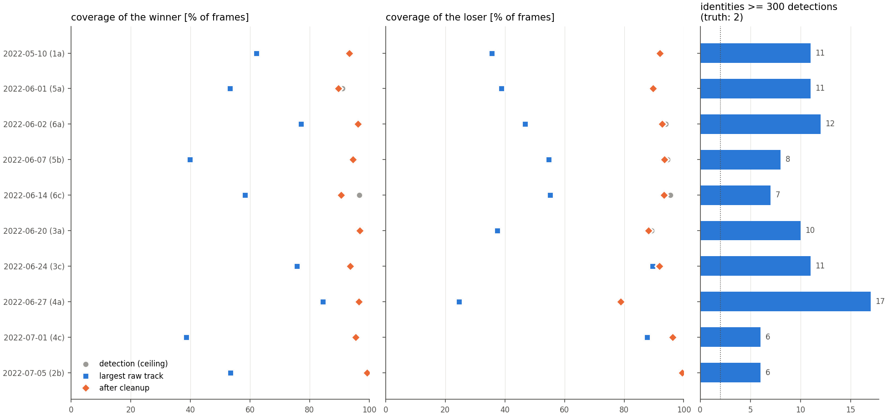

Tracks of a rise-heavy trial before and after `cleanup -n 2` (successive
identities of one fish alternate light/dark):

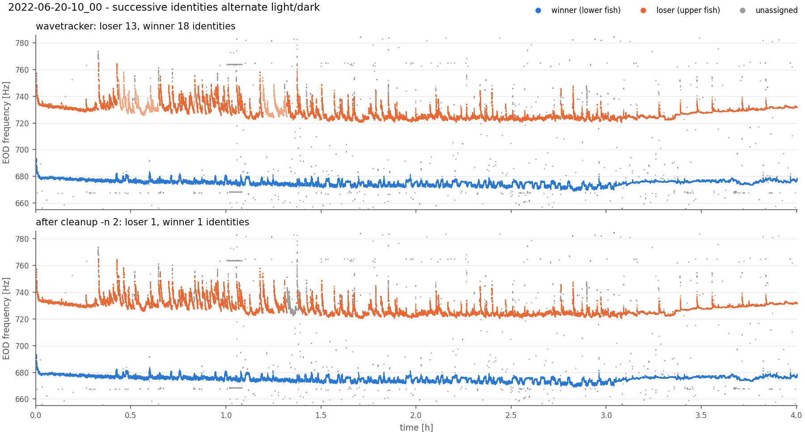

## Recordings that start without fish

Results for a fish must not depend on what a recording starts with.
`benchmarks/fish_free_start.py` puts real fish-free data in front of a real recording
with fish, and compares the fish one to one with the recording alone, so that no
ground truth is needed.

The deployment below (16 channels, 48 kHz, `min_group_size: 2`, no absolute power
limit, no mains) was started at 11:18, and fish come at dusk, around 19:00. The first
measure is the part of 262 minutes of fish tracks in 2.5 h of night that is detected,
the fish taken from the most sensitive run. The night is analysed alone, after the 8 h
of day, and after 10 min of real static:

| threshold factors | fish found, before: alone / day / static | after |
|---|---|---|
| 6 and 10 (default) | 2 / 100 / 93 % | 35 / 35 / 35 % |
| 4 and 7 | 21 / 93 / 88 % | 76 / 77 / 76 % |
| 3 and 5 | 62 / 89 / 86 % | 92 / 92 / 92 % |

Before, the result depended on the noise of the first block. The price of that
sensitivity in the empty day and in the static, per frame:

| threshold factors | false detections, before: day / static | after |
|---|---|---|
| 6 and 10 (default) | 3.3 / 3.6 | 0.02 / 0.02 |
| 4 and 7 | 13 / 8.5 | 0.17 / 0.27 |
| 3 and 5 | 29 / 24 | 1.4 / 5.5 |

With factors 4 and 7, before and after:

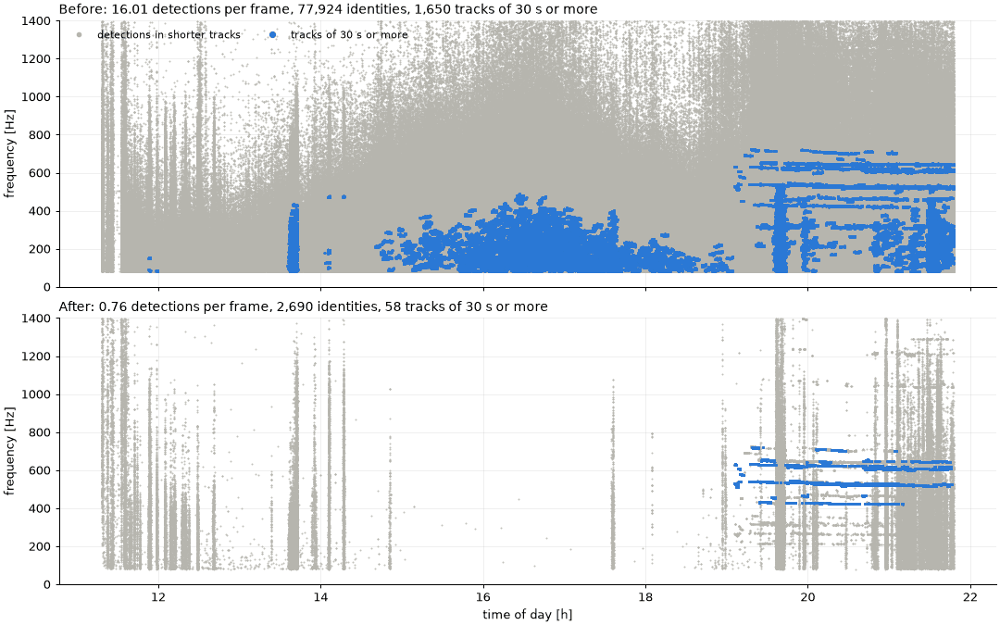

The night's tracks of 30 s or more number 50 alone, 53 after the day and 55 after the
static, and 87 % of them stay one identity. Before they numbered 24, 604 and 2055.
Fish-free recordings, at the default settings:

| 35 to 70 min, no fish | detections per frame | identities |
|---|---|---|
| static | 2.83 → 0.01 | 6400 → 23 |
| quiet, then in the water | 1.65 → 0.02 | 1850 → 63 |
| quiet, then in the water | 0.58 → 0.03 | 1290 → 128 |
| in the water, with noise bursts | 1.13 → 0.01 | 2273 → 25 |

What it costs, on recordings with fish:

| | before | after |
|---|---|---|
| tube trials (8), fish detected, winner / loser [% of frames] | 96.1 / 92.0 | 95.6 / 91.4 |
| ... after `cleanup -n 2` | 95.0 / 91.4 | 94.4 / 91.0 |
| ... identities | 485 | 186 |
| ... purity | 1.000 | 1.000 |
| Iriri chorus, detections per frame | 60.4 | 57.7 |
| runtime of a 4 h tube trial [s] | 62 | 67 |

The worst single tube trial lost 5 points after cleanup (6a, winner, 96.3 to 91.1 %),
others gained up to 6 (6c, winner). Two settings are trade-offs, measured there. A
click threshold of 8 finds more of the night's fish at 4 and 7 (81 % of a stretch
against 58 %), but broke the tracks of 2 of the 16 lab fish apart. Stronger thresholds
over frequency remove more false detections in noise bursts at the cost of fish: on
the fish of that night, 0.7 instead of the 0.6 of `DetectionThresholds.BAND_SCALE`
lost 6 points of what is found without bands, and gained 0.01 per frame.

## Dense mixtures of tube recordings

`benchmarks/tube_mixture.py` (superseded by the
[dense mixtures](#dense-mixtures-with-power-augmentation) below) sums 8
two-fish tube recordings electrode by electrode. Each source is time-warped (frequency scale 0.4-1.6, plus a slow
drift common to all sources, std 0.5 % over ~5 min) so fish spread over
250-1300 Hz with natural modulations and harmonics land among other fish;
hum combs are removed first. Ground truth comes from tracking each source
alone. `benchmarks/harmonic_comodulation.py` scans the timescale,
`benchmarks/harmonic_rule.py` evaluates the rule per identity.

## Dense mixtures with power augmentation

`benchmarks/dense/` builds a benchmark of up to 30 fish from the two-fish
tube-competition recordings of 2019/20 (3x3 and 5x3 grids) and 2022 (1x11),
with ground truth, and lowers the power of single fish or of whole dyads to
emulate fish that are far from the electrodes. The data live outside the
repository, in `$WT_BENCHMARK_DATA` (default `~/wrk/data/wavetracker_benchmark`),
so that every worktree uses the same files.

```bash
python benchmarks/dense/library.py --plot        # 1. sources: track each trial alone
python benchmarks/dense/mixture.py --worker 0/2  # 2. lab mixtures (and --worker 1/2)
python benchmarks/dense/noise.py calibrate       # 3. field noise: level from real fish
python benchmarks/dense/noise.py derive          #    field-noise variants of every mixture
python benchmarks/dense/run.py track --tag mine -c my_config.yaml --split dev
python benchmarks/dense/run.py track --tag mine -c my_config.yaml --split dev-field
python benchmarks/dense/run.py report --tags default mine   # 4. figures, dev and dev-field
python benchmarks/dense/specs.py                 # table and figure of all mixtures
python benchmarks/dense/gallery.py               # spectrograms with the truth
```

A 30-fish mixture needs about 6.5 GB of memory to generate (and a GPU); run
each worker under a memory cap, e.g. `systemd-run --user --scope -p
MemoryMax=10G uv run python ...`, and not more workers than memory allows.

**Sources.** Every trial with two fish at least 20 Hz apart is analysed
alone for 20 min with the species range (400-1200 Hz), which is the reliable
case. Detections are assigned to the lower and the upper fish by two coarse
traces (dominant frequency peaks in 10 s windows); identities carry the
assignment through rises; isolated detections (fewer than 3 of the same fish
within 1 s and 2 Hz: hum, noise) are dropped.

**Complete truth.** Detections are not the fish: on lab recordings the
tracker leaves 6 % of the frames of a fish empty on average and up to 40 %
for single fish, mostly during rises and where a fish sits on a mains
harmonic (which detection excludes). Every gap of a fish's detections is
therefore bridged by following its ridge in the electrode-summed spectrogram
(wavetracker's frames and resolution) with dynamic programming, from the last
to the next detection, in a band from 6 Hz below to 40 Hz above the
interpolated track (rises), never within 4 Hz of the other fish and not on
hum teeth or stationary lines away from the fish. A frame is kept if the
ridge is at least 6 dB above the local floor and within 25 dB of the
detections around the gap, and if the path is continuous there. The truth
then covers 99.9 % of the frames (worst fish 97 %), so that completeness,
the fraction of a fish's frames with a detection, can be scored.

A source is kept if the ratio of its two fish frequencies matches the trial
metadata within 3 % (the metadata EODfs are temperature corrected, their
ratio is not), the two traces are closer than 3 Hz in less than 1 % of the
frames (not two traces on one fish), and at least half of each fish was
detected (completion follows hum as readily as a fish where there is little
to anchor it): 52 of 56 trials. Trials are split by fish group: 2019 groups 5
and 6 and the 2022 pairings 5 and 6 are the **test** pool (22 sources), all
others **dev** (30), so no individual of the test mixtures is seen while
developing. Contact sheets of all sources, detected and completed truth:
`$WT_BENCHMARK_DATA/figures/library_*.png`.

**Splitting a source into its fish.** In a short-time Fourier transform
(0.82 s, 75 % overlap) the bins within a few Hz of every harmonic of a fish's
trace belong to that fish (wider where the trace moves fast or is unknown).
In the masks a fish takes only what stands out of the noise (spectral
subtraction with over-subtraction 4), and the residual is filled with noise
of the local level there: the transform of white noise, shaped by the noise
spectrum away from the fish and by its changes over time in 200 Hz bands.
Stationary lines (hum teeth, crosstalk lines 4 dB above their surroundings)
are replaced by that noise. Near a fish, power in the residual more than
7.8 dB above the noise (chirp smears, a fish line off its trace) moves to the
fish. The parts add up to the source exactly (except at the lines), the noise
under a fish stays in the residual (where it is scaled like all noise), and a
fish attenuated to nothing leaves the noise of the recording, not a hole and
not a ghost (leakage is 44 dB below the fish).

**Mixing.** Every source is time-warped, `tau(t) = start + a (t + D(t))`:
the scale `a` places its two fish in the band of the scenario (dyad centres
stratified over the band, so density is controlled), `D` is a slow drift
common to all sources. Fish keep their natural frequency modulations, rises,
chirps, waveforms and electrode patterns; for low fish (a down to 0.09) all
of these are slowed by 1/a. Each source's 9 best electrodes are mapped onto
the 9 mixture electrodes in random order. The residual of each source is
scaled by `sqrt(a / n_sources)`, which keeps the noise floor of the mixture
at that of one recording for any number of sources and any scale.

**Augmentation.** Per fish (or per dyad), in dB: a static offset, a linear
ramp (`ramp_db`), a slow Ornstein-Uhlenbeck wander, fades of a fish that
swims away and comes back, and a slow independent gain per electrode (the
pattern changes as the fish moves). `fraction` limits it to some fish or
dyads.

**Noise: lab and field.** Every mixture exists twice. The *lab* mixtures
(`dev/`, `test/`) keep the noise of the lab recordings, against which the fish
have 40-60 dB: what tracking can do when noise is not the problem. The *field*
mixtures (`dev-field/`, `test-field/`) add real fish-free noise from the empty
day of a 16-electrode logger grid in the Iriri (iriri01-grid01-dev03, fish
come at dusk): 10 min per mixture, none used twice, dev and test from
different hours, resampled to 20 kHz on a 3x3 block of the 4x4 grid, so that
the noise keeps its spectrum (rising towards low frequencies), its
correlation across electrodes (|r| about 0.7) and its events (clicks, bursts).
Its level is set by the EOD amplitude of a fish next to an electrode in both
systems: wavetracker's power at the fundamental on the best electrode, the
median of the lab fish against the 95th percentile of the 7 fish tracked in
20 min of the same deployment's night. A lab fish at 0 dB gain is then as far
above the field noise as a field fish next to an electrode, and the
attenuation of the scenarios is distance. The absolute numbers are those of
the field mixtures. Calibration: `figures/field_noise_calibration.png`.
Not included yet: the night of that deployment is 10-20 dB above the day
floor below 1.2 kHz, a chorus of many unresolved fish.

**Truth.** Per fish, on a 10 Hz grid: frequency (NaN where unknown), the
gain applied, and the SNR of its fundamental in the mixture (power at the
truth frequency over the noise floor at that frequency, both summed over
electrodes, at wavetracker's default resolution of 0.61 Hz). The noise floor
comes from mixing the residuals alone as well, and the fish and noise power
are stored, so that other floors can be put under the same fish. Full-power
fish have a median SNR of 44-52 dB in the lab mixtures and about 20 dB in the
field mixtures (10 % of their frames below 7 dB).

**Scenarios** (`benchmarks/dense/suite.yaml`, 10 min each, dev and test):

| scenario | fish | band [Hz] | augmentation |
|---|---|---|---|
| density-04/10/20/30 | 4-30 | 400-1100 | none |
| crowded-30 | 30 | 550-850 (nearest neighbour 4 Hz, median) | none |
| lowonly-10 | 10 | 70-300 | none |
| lowfreq-30 | 30 | 60-1300, log | none |
| atten-fish-30 | 30 | 150-1300, log | every fish: static 0 to -40 dB, wander, fades 10-40 dB, electrode drift |
| atten-dyad-30 | 30 | 150-1300, log | half the dyads at -15 to -45 dB, fades, electrode drift |
| ladder-10/30 | 10, 30 | 300-1300 / 150-1300 | every fish ramps by 60 dB, in or out |

**Scoring** (`benchmarks/dense/score.py`). Detections are matched one to one
per frame to the truth (within 2 Hz). *Completeness* (recall) counts the
frames of a fish with a matched detection, also only over the frames on which
the fish is at least 6 dB above the floor of the mixture (*visible*);
coverage counts those of its dominant identity, IDF1 assigns identities one
to one to fish (what a user wants: one identity per fish).
Unmatched detections are *harmonic* (on a harmonic or subharmonic of a fish)
or *false*; near a fish whose truth is unknown they are ignored. Every
(fish, frame) is saved with its SNR, gain, frequency and the distance to the
nearest line of another fish, for the curves in the report.

Spectrograms and truth of a lab mixture, the same fish in field noise, and a
ladder (every fish ramps by 60 dB; light: low SNR):

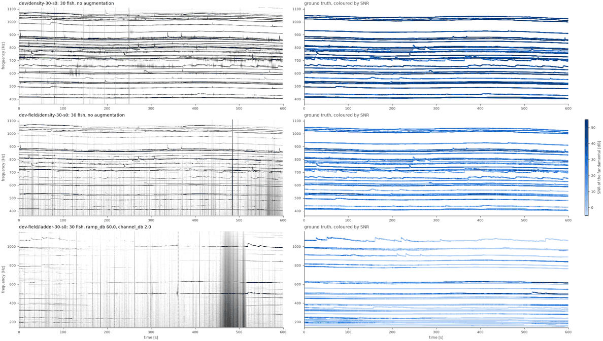

**Baseline** (wavetracker defaults, and the dense-population settings of
`benchmarks/dense/configs/dense.yaml`: grid factors 4/7, `min_group_size: 2`,
stricter links and stitching), dev split, field noise, means over seeds:

| scenario | completeness, default / dense | ... of visible frames, dense | IDF1, default / dense | precision, dense | switches per fish and min, dense |
|---|---|---|---|---|---|
| density-04 | 0.99 / 0.99 | 0.99 | 0.99 / 0.99 | 0.98 | 0.25 |
| density-10 | 0.76 / 0.92 | 0.92 | 0.63 / 0.70 | 0.99 | 1.0 |
| density-20 | 0.67 / 0.86 | 0.92 | 0.68 / 0.70 | 0.98 | 1.3 |
| density-30 | 0.58 / 0.74 | 0.80 | 0.61 / 0.61 | 0.96 | 0.8 |
| crowded-30 | 0.53 / 0.71 | 0.76 | 0.53 / 0.59 | 1.00 | 1.0 |
| lowonly-10 | 0.47 / 0.79 | 0.83 | 0.64 / 0.76 | 0.97 | 0.13 |
| lowfreq-30 | 0.42 / 0.67 | 0.75 | 0.53 / 0.63 | 0.83 | 0.42 |
| atten-fish-30 | 0.13 / 0.22 | 0.73 | 0.18 / 0.22 | 0.74 | 0.44 |
| atten-dyad-30 | 0.29 / 0.40 | 0.79 | 0.40 / 0.37 | 0.84 | 0.42 |
| ladder-10 | 0.14 / 0.22 | 0.83 | 0.23 / 0.31 | 0.85 | 0.35 |
| ladder-30 | 0.11 / 0.20 | 0.74 | 0.19 / 0.25 | 0.79 | 0.33 |

In lab noise the dense settings reach 0.83 completeness and IDF1 0.68 on
density-30 (defaults 0.69 and 0.70), but their thresholds then pick up
harmonics: 14 harmonic detections per frame on lowfreq-30 (precision 0.62).
What limits tracking, in field noise:

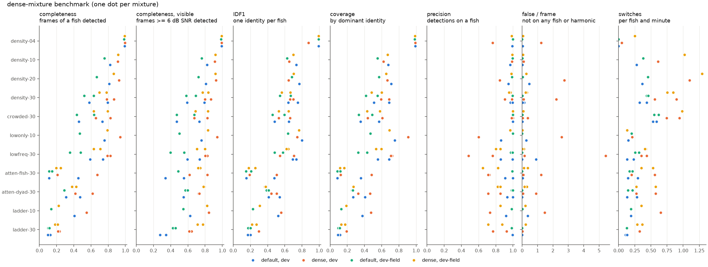

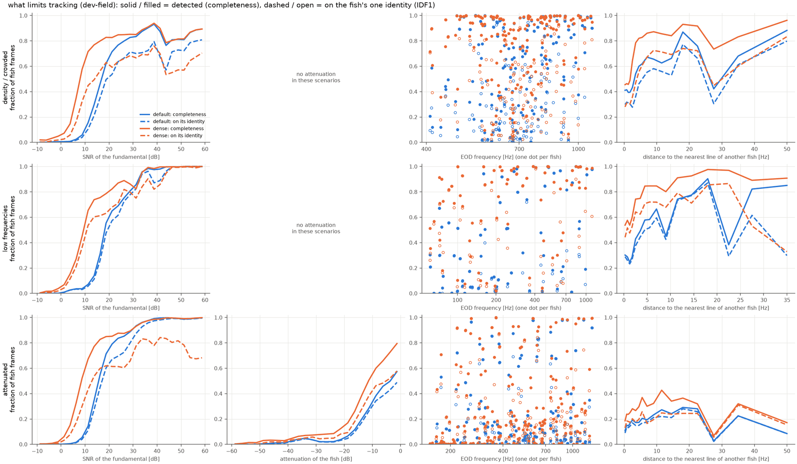

* **Density, not noise, costs completeness first.** Already at lab SNR
  completeness falls from 0.99 with 4 fish to 0.69 (defaults) or 0.83 (dense)
  with 30, although every fish is 40-60 dB above the noise. Strong fish
  within 1 Hz of another fish's line are found in under half of their frames,
  within 1-3 Hz in two thirds, farther away in all of them (two fish that
  close make one spectral peak at 0.61 Hz resolution).
* **Identities break more than detections fail.** With 10 or more fish, a
  fish's frames on its one identity (dashed) are 10-25 points below its
  detected frames; fish change identity about once per minute with the
  dense settings, mostly at rises and at close neighbours.
* **SNR**: half of a fish's frames are found at about 8 dB SNR of the
  fundamental with the dense settings and about 15 dB with the defaults.
  Moved away from a near-electrode position, a fish has lost half of its
  detected frames at 14 dB attenuation (dense, 0.80 to 0.40; defaults at
  11 dB, 0.57 to 0.28) and four fifths at 19 dB. Of the frames still visible
  (>= 6 dB), the dense settings find 73-83 % in the attenuation scenarios.
* **Low frequencies**: in field noise, fish below 150 Hz are found in a
  median 63 % of their frames with the dense settings (quartiles 37-81 %)
  and 12 % with the defaults, fish at 150-300 Hz in 87 % and 38 %, above
  300 Hz in 88 % and 78 %. Half of the fish in lowfreq-30 have another fish's
  line (a harmonic) within 1.4 Hz.
* Harmonics of strong fish tracked as fish are the main false detections
  (1.5-4 per frame in the attenuated and low-frequency scenarios, dense).

### Splits for the learned detector

A network trained on spectrogram crops of the training mixtures could learn
the individual fish (their harmonic spectra, chirps, rises, electrode
patterns) instead of what makes a fish, and then score well on mixtures of
the same fish. `dev` and the `train` split of the
[linker](#learned-fragment-linking) draw on the same dev sources, which is
fine for features of tracker fragments but not for a network that sees the
spectrogram. The learned detector therefore has two splits of its own, drawn
by fish group from the dev sources (`mixture.POOL`, `library.json`
unchanged); the test groups stay unseen:

| split | fish groups (dev sources) | trials | mixtures | field noise (`-field`) |
|---|---|---|---|---|
| `ltrain` | 2019 group 3, 2022 pairings 1-3 | 20 | 26 (`learned_train.yaml`) | the next day of the noise recording, 10:48-15:08, used by no other split |
| `ldev` | 2019 group 4, 2022 pairing 4 | 10 | 17 (`learned_dev.yaml`) | the dev hours, as `dev-field` |

`ldev` has the scenarios and seeds of `suite.yaml`. Its 10 trials are fewer
than the 15 sources of a 30-fish scenario, so a pool smaller than the design
uses every trial once and as few as needed a second time (5 in each 30-fish
mixture), each copy with its own frequency scale, offset and electrode
order; such a fish appears twice, at different frequencies. Splits with
large enough pools draw exactly as before (the sources of all 53 dev, test
and train mixtures replay identically). `ltrain` covers the same families at
other densities and bands (6-30 fish, seeds 200 and 201). Its field noise
comes from the second day of the noise recording, 2026-09-06, which is as
empty as the first: in every other file from 09:38 to 16:18 no line stands
more than 0.4 dB above the floor of the 5-min mean spectrum, while the fish
of the night stand 7-12 dB above it (before 10:30 the floor is up to 30 dB
higher, so those hours are not used).

```bash
python benchmarks/dense/mixture.py --suite benchmarks/dense/learned_dev.yaml
python benchmarks/dense/mixture.py --suite benchmarks/dense/learned_train.yaml
python benchmarks/dense/noise.py derive --splits ldev ltrain   # ldev-field, ltrain-field
python benchmarks/dense/run.py track --tag classic-ldev -c benchmarks/dense/configs/dense-linked.yaml --split ldev   # and ldev-field
```

**Classic baseline** (run tag `classic-ldev`): the dense settings with the
linker (`configs/dense-linked.yaml`), wavetracker b833de9, means over seeds,
lab / field noise:

| scenario | IDF1 | recall | recall, detected frames | false per frame | harmonic per frame | false identities >= 30 s |
|---|---|---|---|---|---|---|
| density-04 | 0.87 / 0.86 | 0.80 / 0.79 | 0.79 / 0.78 | 0.03 / 0.03 | 0.0 / 0.0 | 0 / 0 |
| density-10 | 0.90 / 0.83 | 0.87 / 0.85 | 0.88 / 0.85 | 0.02 / 0.02 | 0.0 / 0.0 | 0 / 0 |
| density-20 | 0.80 / 0.78 | 0.76 / 0.74 | 0.76 / 0.75 | 0.02 / 0.02 | 0.0 / 0.0 | 0 / 0 |
| density-30 | 0.83 / 0.78 | 0.80 / 0.74 | 0.80 / 0.74 | 0.12 / 0.16 | 0.1 / 0.5 | 0 / 0 |
| crowded-30 | 0.62 / 0.60 | 0.63 / 0.62 | 0.63 / 0.62 | 0.03 / 0.03 | 0.0 / 0.0 | 0 / 0 |
| lowonly-10 | 0.84 / 0.76 | 0.93 / 0.64 | 0.93 / 0.63 | 0.92 / 0.01 | 2.2 / 0.0 | 5 / 0 |
| lowfreq-30 | 0.71 / 0.67 | 0.77 / 0.70 | 0.77 / 0.69 | 0.33 / 0.27 | 8.6 / 6.6 | 28 / 15 |
| atten-fish-30 | 0.48 / 0.40 | 0.36 / 0.30 | 0.36 / 0.30 | 0.60 / 0.50 | 2.9 / 2.6 | 8 / 5 |
| atten-dyad-30 | 0.53 / 0.50 | 0.48 / 0.46 | 0.48 / 0.46 | 0.12 / 0.43 | 5.3 / 5.5 | 17 / 18 |
| ladder-10 | 0.42 / 0.40 | 0.31 / 0.30 | 0.31 / 0.30 | 0.55 / 0.52 | 1.5 / 1.5 | 2 / 2 |
| ladder-30 | 0.35 / 0.30 | 0.27 / 0.21 | 0.26 / 0.20 | 0.45 / 0.28 | 3.6 / 3.0 | 12 / 8 |
| **mean of the 17 mixtures** | **0.639 / 0.597** | **0.605 / 0.551** | 0.604 / 0.549 | 0.28 / 0.23 | 2.6 / 2.2 | 8.1 / 5.5 |

The same settings reach IDF1 0.641 / 0.613 and recall 0.673 / 0.569 on
`dev`. `ldev` is harder in lab noise because its fish are weaker: six of the
seven 2019 group 4 recordings put their fish only 20-25 dB above the lab
noise of a mixture (median SNR of all fish frames 18 dB, against 28 dB on
`dev` and 40 dB on `test`); in field noise the splits are alike (13 and
14 dB). The `ltrain` fish are strong (38 dB in lab noise, no unattenuated
fish below 20 dB, against a third of them in `ldev`), so in training weak
fish come from the attenuation scenarios and the field noise. The learned
detector is compared against these numbers, on the same splits.
Figures: `$WT_BENCHMARK_DATA/figures/summary_classic-ldev_ldev_ldev-field.png`
and `curves_classic-ldev_ldev*.png` (`run.py report --tags classic-ldev
--splits ldev ldev-field`).

## Learned detector (v1)

`detector.method: learned` (`wavetracker/salience.py`) replaces peaks and
harmonic groups with a small convolutional network: the electrode-summed
spectrogram, normalised per frame in 100 Hz bands, goes in as a harmonic
stack (channel h at candidate bin k is bin h*k, for h = 1/3, 1/2, 1..5); six
convolution layers (32 channels, about 81k parameters) with time dilations
see +-7 Hz and +-5 s; the output is a salience (probability of a
fundamental) and a sub-bin offset per bin. Peaks above `detector.threshold`
become detections; tracker and linker are unchanged.

Training (`benchmarks/dense/salience_train.py --tag v1`, 5000 steps of 8
crops, 78 min on an RTX 4080): crops of the 26 `ltrain` mixtures with their
field noise mixed in at a random gain (0 = lab, 1 = the field variant, up to
3; the truth's fish and noise powers give the SNR at any gain), random
electrode subsets, Gaussian targets (sigma 0.6 Hz) at the truth
fundamentals; ignored in the loss: fish frames below -3 dB, stretches the
truth does not know and persistent lines that are no truth fundamental or
harmonic (found on the lab variant); ridge-completed frames at half weight;
harmonics of truth fish are negatives. The model is packaged as
`wavetracker/models/salience.pt`; `configs/learned-linked.yaml` is
`dense-linked.yaml` with the learned detector.

On `ldev` (17 mixtures each, same tracker and linker; `strata.py`), the
threshold 0.6 is best for lab and field noise alike (0.4-0.7 tried):

| | IDF1 | recall | precision | harmonic/frame | false ids >= 30 s |
|---|---|---|---|---|---|
| classic, lab | 0.639 | 0.605 | 0.832 | 2.65 | 8.1 |
| learned, lab | **0.727** | 0.686 | 0.958 | 0.31 | 1.8 |
| classic, field | 0.597 | 0.551 | 0.843 | 2.23 | 5.5 |
| learned, field | **0.711** | 0.667 | 0.954 | 0.40 | 2.2 |

IDF1 is higher in every one of the 17 mixtures (lab and field); detection
takes 1.1 s instead of 2.2 s per 10-min, 9-electrode mixture. Recall by
failure mode (lab / field):

| | classic | learned |
|---|---|---|
| fish at 0-6 dB | 0.04 / 0.13 | 0.32 / 0.58 |
| fish at 6-20 dB | 0.66 / 0.71 | 0.83 / 0.88 |
| visible fish, nearest line < 1.2 Hz | 0.62 / 0.63 | 0.66 / 0.68 |
| visible fish, nearest line 1.2-3 Hz | 0.69 / 0.67 | 0.81 / 0.85 |

Faint fish and false lines move most; pairs closer than the window's
resolution (about 1.2 Hz for 1.64 s Hann windows) barely, as expected for a
detector that sees only the summed spectrogram. A ByteTrack-style start
(`tracking.start_salience`) did not help: with detections at 0.4-0.5 and
starts at 0.7, IDF1 was 0.68-0.70 on lab against 0.72 for a plain 0.7
threshold, since weak detections still link into existing identities.
Some remaining "false" identities are long, stationary lines, e.g. near
810 Hz through `ldev/ladder-30-s0`, probably real lines the truth does not
know.

Figures: `figures/strata_learned_v1.png`, `figures/curves_classic-ldev_s5000-t0.6_ldev.png`
(and `_ldev-field`), `figures/tracks_s5000-t0.6_ldev_ladder-30-s0.png`.

### What limits v1 (step A)

All on `ldev` / `ldev-field` (lab / field noise), same tracker and linker
unless stated; IDF1 is the mean over the 17 mixtures of each.

**Ceilings** (`benchmarks/dense/oracle.py`; figure `figures/A-ceilings.png`):

| | IDF1 |
|---|---|
| classic | 0.639 / 0.597 |
| classic detections, truth identities | 0.729 / 0.684 |
| learned v1 | 0.727 / 0.711 |
| learned v1 detections, truth identities | 0.790 / 0.775 |
| truth detections >= 0 dB, real tracker + linker | 0.775 / 0.740 |
| truth detections >= 0 dB, truth identities | 0.887 / 0.843 |

What is left to v1 (0.16 / 0.13 up to what is above the noise) is split
about evenly: detection 0.07 / 0.05, association 0.09 / 0.08 (average of the
two orders of fixing). Most of the association loss is the tracker's own
fragments mixing close fish (purity 0.95 with perfect detections; truth
detections reach only 0.53 / 0.63 IDF1 on `crowded-30`) and joins the
linker cannot make; the linker's decisions cost 0.016, tracker parameters
nothing (12 settings within +-0.005; `max_dt` 5 is as good and 2.6x faster).
The linker retrained on learned fragments of `ltrain` gives +0.011 at a
link threshold of 0.7 (model in `$WT_BENCHMARK_DATA/salience/`, not
packaged).

**Capacity, data and seed** (5000 steps each, best of thresholds 0.5-0.7):

| model | IDF1 |
|---|---|
| 32 channels, 26 mixtures (v1) | 0.727 / 0.711 |
| 32 channels, 26 mixtures, seed 1 | 0.720 / 0.702 |
| 32 channels, 13 mixtures | 0.714 / 0.699 |
| 64 channels, 26 mixtures | 0.730 / 0.712 |
| 64 channels, 13 mixtures | 0.722 / 0.708 |

A different seed moves IDF1 by about 0.008; doubling the mixtures or the
width adds about as much each. The wider network detects better at the same
threshold (lab, 0.6: recall 0.700 vs 0.686 at precision 0.965 vs 0.958;
recall with a line 1.2-3 Hz away 0.849 vs 0.813), but IDF1 hardly follows:
association limits it as much as detection. The halved data are fewer
mixtures of the same 20 trials, not fewer fish.

**Recording edges.** Without context at the start and end of a recording,
v1 padded with zeros and gave bursts of false detections there (46-60
identities per 5-minute field file); the context is now mirrored from the
data (precision 0.958 -> 0.964, IDF1 +0.001 on `ldev`; edge identities in
field files 0-2). With the mirrored edges and the retrained linker, v1
reaches 0.739 / 0.723.

**Real field recordings** (`benchmarks/field_check.py`, no truth): on four
night files of the 16-electrode grid `iriri01-grid01-dev03` and the
2-electrode boat take `DR0000_0209`, the learned detector follows faint
fish the classic one misses or fragments (identities >= 30 s per grid file
15/16/13/8 vs 7/11/8/2) and leaves fewer stray detections in noise bursts.
Open problems seen there: a strong 308 Hz fish on the boat take detected in
19 % of its frames (classic 60 %), and occasional harmonics reported as a
second fish. Figures: `figures/field_side_by_side/`.

### Association for the learned detector (step B)

With the detections of learned v1 fixed, `benchmarks/dense/assoc_diag.py`
compares the tracker's raw fragments with the truth: where a fragment
switches fish, where a fish's fragments break, and what each situation costs
(details and all experiments: `benchmarks/dense/association_notes.md`).
Of the 0.051 / 0.052 IDF1 between v1 and its truth identities, joining the
fragments costs 0.030 / 0.031 (the linker refusing joins at rises, missing
candidates for rise onsets, and its threshold), switches inside fragments
0.012 / 0.011 (78 % at crossings, half of them where the two fish are one
line, which no tracker can get right), and harmonic and false detections
inside identities 0.008 / 0.009. With truth detections, crossings dominate
(0.05).

`configs/learned-assoc.yaml` combines what helped: the tracker's motion model
(`tracking.motion_window: 2`, see
[algorithms](algorithms.md#following-the-frequency-slope-motion-model)), a
linker retrained on that tracker's `ltrain` fragments (threshold 0.6),
looser shared-frame and parallel rules in the linker's association
(`max_shared` 0.3, `max_parallel` 0.6: both refused mostly true joins at
rises), and dropping identities whose mean salience is below 0.75
(`tracking.min_identity_salience`):

| | IDF1 | purity | false ids >= 30 s | switches / fish / min |
|---|---|---|---|---|
| v1, `learned-relinked.yaml` | 0.739 / 0.723 | 0.981 / 0.981 | 1.6 / 1.9 | 0.43 / 0.46 |
| v1, `learned-assoc.yaml` | **0.750 / 0.737** | 0.980 / 0.983 | 0.9 / 0.9 | 0.26 / 0.29 |
| truth detections >= 0 dB, `dense-linked.yaml` | 0.775 / 0.740 | 0.954 / 0.956 | 0 / 0 | 1.82 / 1.67 |
| the same + motion model and association rules | **0.790 / 0.757** | 0.955 / 0.959 | 0 / 0 | 1.43 / 1.29 |

It is better in 15 / 13 of the 17 mixtures (lab / field) and worse in 1 / 0.
The motion model keeps crossing fish apart (with truth detections, frames
with a neighbour within 3 Hz on their fish's identity: +0.03-0.04), but for
learned detections it needs the retrained linker. Tracking takes twice as
long. Figures: `figures/assoc_diagnosis.png`, `figures/assoc_results.png`,
`figures/strata_assoc.png`.

### Detector and association together (step B)

The detector track (`salience_train.py` options `--temporal-dilations`,
`--channels`, augmentations; `det_sweep.py`; notes in
`$WT_BENCHMARK_DATA/salience/B-det-NOTES.md`) added a temporal stack to the
network: 7 residual layers along time per frequency bin (dilations 1-64,
about 52 s of context) on a trunk of width 64. Training is 4x faster (data
prepared on the GPU). Through the step-A tracker and linker, two seeds give
mean IDF1 (lab and field) 0.742 against 0.730 for v1, best at threshold 0.7.
Most misses near close lines are a decoding limit: two fundamentals one bin
apart give one peak.

Through the step-B association (`configs/learned-assoc.yaml`), mean IDF1 of
lab and field, best of thresholds 0.6 / 0.7:

| detector | seed 0 | seed 1 | harmonic/frame | false ids >= 30 s |
|---|---|---|---|---|
| v1 (association only) | 0.744 | | 0.28 / 0.37 | 0.9 / 0.9 |
| temporal stack | 0.746 | 0.751 | 0.31 / 0.40 | 1.1 / 1.5 |
| temporal stack + augmentations | 0.747 | 0.743 | 0.11 / 0.18 | 0.5 / 0.6 |

(harmonics and false identities lab / field, seed 0, threshold 0.6.) The
augmented model (speed perturbation 0.85-1.18, spectral tilt, hard negatives
at 1/5-5 times strong fish, harmonic channels 1/5 ... 5) is as good in IDF1
and much cleaner: a third of the harmonic detections, half the false
identities, at slightly lower recall of faint fish. On the field grid it no
longer reports the 2nd harmonic of a masked fish as a fish. The seed spread
(about 0.005) is now as large as the differences: further decisions need
more seeds or a larger dev split. `configs/learned-b.yaml` is the candidate
(augmented model, seed 0, threshold 0.6): 0.752 / 0.741, against classic
0.639 / 0.597 and v1 at the end of step A 0.739 / 0.723.

## Learned fragment linking

On the dense mixtures, identities break much more often than detections
fail. The tracker's fragments are almost all pure (98.7-99 % of the matched
detections of a fragment are on one fish), so the loss is in joining them:
assigning every tracker fragment to its true fish would raise IDF1 on the dev
mixtures from 0.56 (dense settings, with stitching) to 0.69, and fragments
shorter than 10 detections hold almost none of that. The learned linker
(`linking.enabled: true`, see [Learned linking](algorithms.md#learned-linking))
replaces the stitching with a link classifier and a constrained greedy
association; it is on by default. The baselines of this benchmark
(`configs/default.yaml`, `dense.yaml` and their variants) keep the stitching
(`linking: {enabled: false}`) so that their numbers stay as documented;
`dense-linked.yaml` is the dense settings with the linker, `default-linked.yaml`
the defaults as shipped.

**Training data.** `benchmarks/dense/train.yaml` adds a third split, `train`:
the same generator and scenario families, other seeds, densities (16, 24 fish)
and bands, drawn from the dev sources (so the dev suite stays a validation
set and the test pool unseen), 19 mixtures and their field-noise variants
(the dev hours of the noise recording shifted by one file). Candidate links
and their features are computed on the tracker's fragments of four detection
settings, so that the model does not depend on one resolution or electrode
count: the dense settings (`configs/dense.yaml`), the defaults, the dense
settings at half the frequency resolution (`dense-nfft14.yaml`, 1.22 Hz,
82 ms frames) and with only two of the nine electrodes (`dense-2ch.yaml`):
48,000 labelled pairs. A pair is labelled "same fish" if the majority
fish of both fragments is the same, and weighted by the square root of the
smaller fragment's detections (what a wrong decision costs).

```bash
python benchmarks/dense/mixture.py --suite benchmarks/dense/train.yaml --worker 0/2  # and 1/2
python benchmarks/dense/noise.py derive
python benchmarks/dense/run.py track --tag dense -c benchmarks/dense/configs/dense.yaml --split train   # and train-field, other configs
python benchmarks/dense/linker.py build --base dense            # pairs, features, labels (all splits)
python benchmarks/dense/linker.py train --base dense --extra-bases default dense-nfft14 dense-2ch
python benchmarks/dense/linker.py sweep --models <model.npz>     # dev: thresholds, against the oracle
python benchmarks/dense/linker.py tradeoff --model wavetracker/models/linker.npz
```

**Results** (dev suite, means over the mixtures; oracle: every candidate
link decided by the truth, the bound of candidates and association):

| detections | noise | stitching IDF1 / purity | linker, threshold 0.9 (default) | linker, 0.5 | oracle IDF1 |
|---|---|---|---|---|---|
| dense settings | lab | 0.560 / 0.986 | **0.641 / 0.986** | 0.659 / 0.983 | 0.667 |
| | field | 0.517 / 0.988 | **0.613 / 0.989** | 0.627 / 0.983 | 0.638 |
| defaults | lab | 0.572 / 0.983 | 0.610 / 0.984 | 0.620 / 0.982 | 0.622 |
| | field | 0.472 / 0.985 | 0.505 / 0.988 | 0.516 / 0.984 | 0.520 |
| dense, 1.22 Hz | lab | 0.533 / 0.984 | 0.614 / 0.983 | 0.625 / 0.982 | 0.628 |
| | field | 0.476 / 0.984 | 0.551 / 0.983 | 0.561 / 0.980 | 0.566 |
| dense, 2 electrodes | lab | 0.489 / 0.985 | 0.563 / 0.982 | 0.584 / 0.978 | 0.592 |
| | field | 0.342 / 0.985 | 0.421 / 0.977 | 0.432 / 0.973 | 0.443 |

With the dense settings and 10 or more fish, a fish needs 1.4 identities for
90 % of its detections instead of 2.4 (lab) and 1.5 instead of 2.7 (field),
it changes identity 0.40 instead of 0.55 times per minute, and the purity
stays the same (0.985 / 0.988). The threshold trades the two:

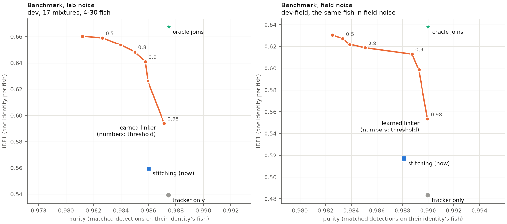

* The default threshold 0.9 keeps identities as pure as the stitching with
  the dense settings and the defaults; with two electrodes they are 0.3-0.8 %
  less pure (the electrode pattern says little there).
* Without the electrode pattern features the linker reaches the same IDF1
  at 0.1-0.2 points less purity (threshold 0.5; 0.7 points with an earlier,
  smaller feature set). The tube fish move, and the mixtures keep their
  electrode patterns, so the linker is trained and scored on moving fish: in
  10 s windows a fish's pattern changes by 2.7 dB rms within 10 s (median
  over the 104 fish; about the scatter of the estimate itself), 4.5 dB within
  a minute and 6.3 dB within 15 min, and for the median fish 20 % of the
  windows are more than 6 dB from its own median pattern (the most mobile
  tenth: half). Some fish hardly move (0.5-1.5 dB at any lag, in the tube);
  the 2022 fish (1x11 electrodes) change more than those of 2019/20 (6.5 vs
  3.5 dB within a minute). `benchmarks/dense/patterns.py`:

  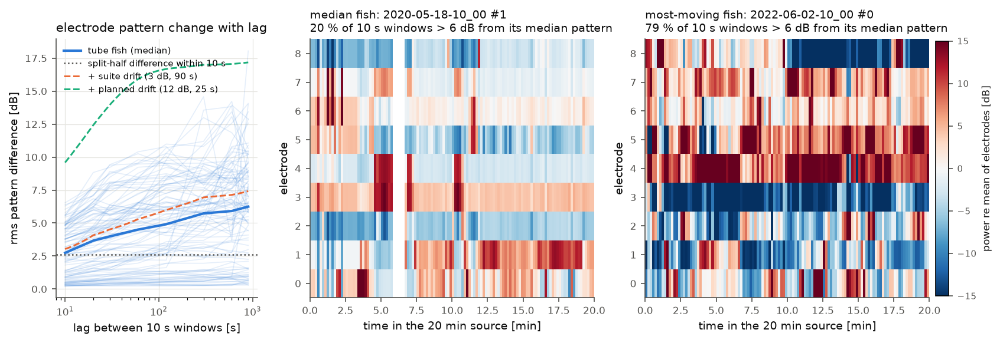
* Joins across rises (jumps of up to 60 Hz within 30 s) add 0.0002 to the
  oracle, and joined different fish on field data, so they are off
  (`linking.rise_df: 0`). Candidates are limited to 5 Hz (the oracle loses
  0.003 against 10 Hz).
* A model trained on one detection setting transfers to the others within
  0.003 IDF1; a larger network or twice the data changed the results by less
  than the spread between seeds (0.003).

**Test suite** (scored once, on 2026-11-06, after all of the above was fixed
on dev; nothing is tuned on it): the held-out fish groups and the test hours
of the noise recording, means over the 17 mixtures of each split.

| detections | noise | stitching IDF1 / purity | linker, threshold 0.9 | gain (dev) |
|---|---|---|---|---|
| dense settings | lab | 0.614 / 0.987 | **0.686 / 0.987** | +0.072 (+0.081) |
| | field | 0.458 / 0.991 | **0.532 / 0.988** | +0.074 (+0.096) |
| defaults | lab | 0.681 / 0.983 | **0.730 / 0.984** | +0.049 (+0.039) |
| | field | 0.357 / 0.992 | **0.390 / 0.992** | +0.033 (+0.033) |

The linker's gain carries over, at the same purity (within 0.003). The
levels differ from dev because the splits do: the test fish are stronger
(median SNR 40 dB against 28 dB in lab noise) and the test hours of the
field recording are louder (median SNR 12 dB against 14 dB), so lab test is
easier and field test harder than dev. GPU detection is not bit-exact from
run to run (about 0.1 % of the detections differ), which moves these means
by about 0.001. Configs: `dense.yaml` / `dense-linked.yaml` and `default.yaml` /
`default-linked.yaml` (the defaults as shipped).

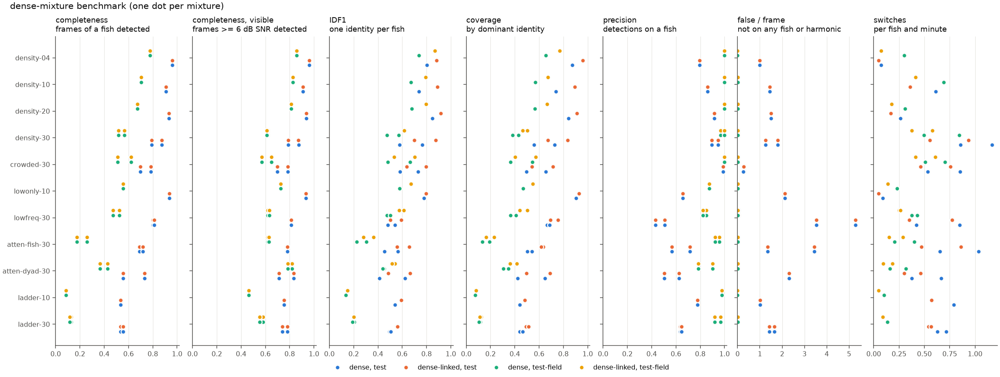

**Spectrogram evidence between fragments (tried, not used).** Linking by eye,
one follows the faint ridge of a fish through the gap and checks its
harmonics. A ridge spectrogram (electrode-summed power in dB above the local
floor, stacked over harmonics 1-3, stored during detection) gave the linker
11 more features per candidate: the strength and visible fraction of the
best path through the gap, where a free path and a ridge tracer with
momentum lead from either end, and whether the two traces meet. On the same
detections (dense settings, two seeds each) they changed IDF1 and purity by
at most 0.003, the spread between seeds, with and without the electrode
pattern features. Where the breaks are explains it: in a gap the fish is
either too faint for a ridge (17 % of the breaks in lab noise, 46 % in
field noise) or within 3 Hz of another fish's line (48 % / 31 %), where its
ridge and harmonics merge with the neighbour's; where it is visible and alone
(26 % / 20 %) frequency continuity already links it. The code is kept as
`$WT_BENCHMARK_DATA/linker/ridge-evidence.patch` (`git apply`), the runs with
ridge spectrograms as `runs/dense-r`.

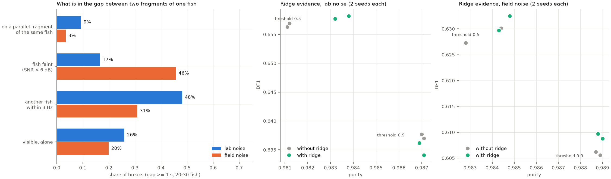

## Completeness: frequency resolution and faint peaks

With the linker, the remaining IDF1 is mostly completeness (dev, dense
settings: recall 0.67 lab, 0.57 field). Of the frames the tracker misses,
56 % (lab) / 72 % (field) have the fish less than 6 dB above the noise
(including the 15 % / 27 % of all frames where augmentation attenuated it
below the noise, which nothing can detect), 32 % / 20 % are visible but
within 3 Hz of another fish's line, and 12 % / 8 % are visible and isolated.
`score.py` also reports recall on the frames the tracker detected in the
source alone (`recall_detected`) and on the frames completed by ridge
following (`recall_completed`), where a detector that follows ridges is
rewarded by construction.

**Frequency resolution 0.31 Hz** (`configs/dense-nfft16.yaml`: 3.3 s windows,
overlap 0.95 for 0.16 s frames; 0.9 overlap loses on rises) raises recall by
0.053 (lab) and 0.061 (field), the same on detected-only frames: fish 1-3 Hz
from another line 0.67 -> 0.81, faint isolated fish (6-15 dB) 0.40 -> 0.66 (a
tone gains 3 dB per doubling), and at every rate of frequency change, rises
included, so detection at two resolutions is not needed. But false
detections double (1.1 -> 2.0 per frame lab, 0.16 -> 0.45 field), precision
drops by 0.05, and the tracker splits fish more often (`density-10`, field:
75 -> 174 identities). The oracle joins of these fragments reach 0.671 / 0.661
(0.667 / 0.638 at 0.61 Hz), the packaged linker 0.616 / 0.609, a linker
retrained with them (`linker/v5-s0.npz`, not packaged) 0.638 / 0.625: about
the same as 0.61 Hz in lab, +0.012 in field. The default stays 0.61 Hz.

**Faint peaks along tracks** (prototype, `benchmarks/dense/faint_peaks.py`, not
in wavetracker yet): a second detection pass at weaker thresholds (3 and 4
noise std, single peaks allowed) gives candidates; after linking, every
identity is extended frame by frame from each of its edges, into its gaps
and past its ends, through the candidate within 0.4 Hz of the predicted
frequency (slope of its last 8 detections), and stops after 2 frames without
one (or 30 s). A candidate within 1.5 Hz of another identity, or on one of
its harmonics or subharmonics, is not taken. At 0.61 Hz: recall +0.041 /
+0.059 (+0.039 / +0.058 on detected-only frames, so not an artefact of the
completed truth), IDF1 0.641 -> 0.646 (lab) and 0.613 -> 0.649 (field),
precision -0.022 / +0.005, purity -0.001. Of the detections added to fish
identities 98 % / 99 % are on the right fish; the false ones extend
identities that are false lines already (lab: 52,000 of 120,000 added, 83 %
false), some of them lines the truth does not know (a 1066 Hz line 28 dB
below the fish runs through all of `density-04-s0`). An electrode-pattern
check removed more true than false candidates (faint patterns are noisy),
and filling before linking gained nothing. At 0.31 Hz, with more false
lines to extend, it costs IDF1 in lab (0.638 -> 0.627) and gains in field
(0.625 -> 0.641).

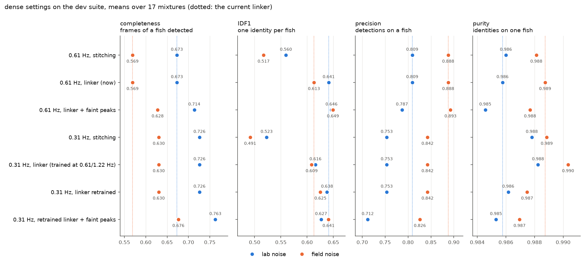

## Low-frequency fish without a 2nd harmonic

`benchmarks/low_frequency.py` synthesizes odd-harmonic fish (no even
harmonics) at 120–300 Hz in a dense 30-fish chorus at 350–900 Hz (2 channels,
48 kHz, field-recording settings) and compares `max_missing_harmonics` 0 and 1.
60 s, three seeds:

| | `max_missing_harmonics: 0` | `1` |
|---|---|---|
| recall of the low fish (fraction of frames) | 0.29 / 0.22 / 0.21 | 0.89 / 0.85 / 0.82 |
| recall of the chorus fish | 0.92 / 0.91 / 0.93 | 0.96 / 0.93 / 0.96 |
| unmatched detections at f/2 of a chorus fish | 57 / 25 / 81 | 31 / 25 / 62 |
| unmatched detections at f/3 of a chorus fish | 64 / 47 / 45 | 29 / 27 / 27 |

(430 frames each.) Groups with gaps cost about two extra unmatched
detections per frame above 900 Hz (chance groups among chorus harmonics).
